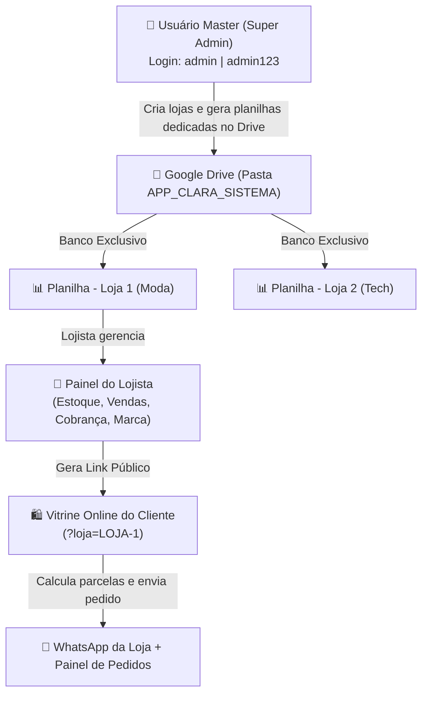

# 🚀 Guia de Uso da Plataforma Multi-Lojas & E-Commerce Clara Gestão

Este documento apresenta o funcionamento da nova arquitetura **SaaS (Multi-Lojas)** com **Bancos de Dados Dedicados no Google Drive**, **Painel Master (Super Admin)**, **Customização de Marca** e **Loja Online Pública para Clientes**.

---

## 🌟 Visão Geral da Nova Arquitetura

---

## 🔑 1. Credenciais de Acesso ao Sistema

Abra o arquivo [`index.html`](file:///c:/Users/victo/OneDrive/Documentos/APP%20CLARA/index.html) no seu navegador. O acesso é restrito e exige a digitação obrigatória de usuário e senha:

| Perfil | Usuário | Senha Padrão | O que pode fazer |
| :--- | :--- | :--- | :--- |
| **👑 Usuário Master** | `admin` | `123` *(ou `admin123`)* | Criar novas lojas com banco próprio, alterar senhas, bloquear/ativar lojas, ver faturamento global e acessar qualquer loja como administrador. |
| **🏪 Lojista 1 (Moda)** | `moda` | `123` | Painel exclusivo da loja de roupas: estoque, PDV, cobrança, cancelamento de vendas com estorno de estoque, customização da marca e pedidos online. |
| **🏪 Lojista 2 (Tech)** | `tech` | `123` | Painel exclusivo da loja de eletrônicos: catálogo próprio, marca própria e regras de parcelamento específicas. |

> [!IMPORTANT]
> **Acesso Rápido Bloqueado por Segurança**: Em conformidade com as boas práticas de segurança, não há botões de preenchimento automático de credenciais. O operador deve sempre digitar seu usuário e senha.

---

## 🛡️ 2. Camadas de Segurança & LGPD (Lei Geral de Proteção de Dados - Lei nº 13.709/2018)

O sistema foi estruturado seguindo as diretrizes da LGPD e os princípios de *Security & Privacy by Design*:

1. **Criptografia e Proteção de Senhas (Art. 46):**
   - As senhas contam com suporte a hash criptográfico **SHA-256** no navegador e no backend do Google Apps Script. Senhas nunca trafegam ou permanecem expostas.
2. **Isolamento de Dados Multi-Tenant:**
   - Cada loja possui sua própria planilha física e dedicada no Google Drive. Um lojista não tem qualquer acesso aos clientes, produtos ou vendas de outra loja.
3. **Loja Online Pública 100% Segura para Clientes:**
   - O link público enviado ao cliente (`?loja=ID`) abre diretamente o catálogo digital, **sem jamais solicitar login ou senha do cliente**.
   - O endpoint público expõe apenas nome, fotos e preços de venda de produtos (custo, margem de lucro e faturamento permanecem estritamente confidenciais no painel do lojista).
   - O cliente conta com **Termo de Consentimento e Privacidade** no checkout online para o tratamento exclusivo de dados de entrega e contato via WhatsApp.
4. **Direito ao Esquecimento e Eliminação (Art. 18):**
   - No cadastro de clientes, a exclusão remove definitivamente os dados pessoais da loja (nome, telefone, endereço, documento), tanto localmente quanto na planilha do Google Drive.

---

## ❌ 3. Cancelamento Seguro de Vendas com Auditoria e Estorno

Na tela **Vendas & Contas a Receber** e na listagem de **Pedidos**, foi implementado o fluxo completo de cancelamento com auditoria:

1. **Camada de Confirmação & Auditoria de Motivo:**
   - Ao clicar no botão de cancelamento, uma janela detalha a venda e exige a seleção do **motivo do cancelamento** (ex: *Desistência do cliente*, *Erro de digitação*, *Produto com defeito*, *Troca*, *Inadimplência*, etc.), além de permitir observações complementares.
2. **Estorno Automático de Estoque:**
   - As quantidades dos produtos vendidos retornam imediatamente ao `Estoque_Atual` da loja.
3. **Anulação Financeira & Histórico:**
   - O saldo devedor é zerado e a venda é marcada como `Cancelada`, não inflando os relatórios de faturamento do lojista.
   - Clicando no badge `CANCELADA`, o lojista abre a **ficha de auditoria** com o motivo registrado, data/hora e confirmação do estorno.
4. **Sincronização com o Google Drive:**
   - A planilha dedicada da loja no Drive é atualizada via API, registrando o status de cancelamento e o motivo na coluna de observações.

---

## 💾 4. Backup & Exportação de Dados (Excel, CSV e JSON)

O sistema conta com ferramentas nativas de extração e salvamento de dados:

1. **Exportar Vendas para Excel / CSV:**
   - Disponível na aba *Vendas & Contas a Receber*. Gera um arquivo `.csv` formatado com separador padrão brasileiro (`;`) e codificação UTF-8 BOM para abertura perfeita no Microsoft Excel e Google Planilhas.
2. **Exportar Estoque / Produtos:**
   - Disponível na aba *Estoque & Produtos*. Baixa lista completa com custos, margens, preços de venda e saldos de estoque.
3. **Exportar Clientes:**
   - Disponível na aba *Clientes*. Exporta cadastros completos com nome, WhatsApp, endereço e histórico.
4. **Backup Completo & Restauração (JSON):**
   - Disponível na aba *Configurações & Drive*. Permite gerar com 1 clique uma cópia de segurança completa de toda a loja (`.json`) e restaurá-la a qualquer momento em caso de troca de computador ou limpeza de navegador.

---

## 🎨 5. Customização da Marca & Regras de Parcelamento (Lojista)

Ao fazer login como lojista, acesse a aba **`🎨 Loja Online & Marca`** para configurar:

1. **Identidade Visual:**
   - **Nome da Loja** e **Slogan**.
   - **Upload do Logotipo** (com preview em tempo real).
   - **Paleta de Cores:** Escolha a cor principal da sua marca (Azul, Verde, Rosa, Roxo, Laranja, Preto ou seletor hexadecimal). Toda a vitrine do cliente e o painel adotam a cor escolhida!
2. **Opções de Entrega & Contato:**
   - **WhatsApp para Recebimento de Pedidos:** Número onde os pedidos dos clientes chegam formatados.
   - **Taxa de Entrega (R$):** Valor cobrado caso o cliente opte por receber em domicílio (Delivery).
   - **Chave Pix da Loja:** Exibida no checkout do cliente para agilizar o pagamento.
3. **Regras de Parcelamento (2 Modelos Implementados):**
   - **Modelo 1 (Padrão - Valor Mínimo por Parcela):** Você define apenas a parcela mínima *(ex: R$ 50,00)* e o teto máximo *(ex: até 6x)*. O sistema calcula automaticamente o limite de parcelas para cada compra dividindo o total pelo valor mínimo!
   - **Modelo 2 (Tabela de Faixas Fixas):** Permite faixas pré-definidas *(ex: até R$ 100 = 1x; até R$ 300 = 3x; acima de R$ 300 = até 6x)*.

---

## 🛍️ 6. Como Funciona a Loja Online do Cliente

1. **Como o cliente acessa:**
   - O lojista clica no botão verde **"Copiar Link da Loja"** na aba *Loja Online & Marca*.
   - O link é gerado no formato: `index.html?loja=ID_DA_LOJA`.
2. **Experiência do Cliente:**
   - O cliente abre no celular e vê o catálogo com o logotipo, slogan e cor tema da loja.
   - Navega pelas categorias, busca produtos e adiciona à sacola de compras.
3. **Checkout Inteligente:**
   - Escolhe entre **"Retirar na Loja (Grátis)"** ou **"Entrega / Delivery (+ Taxa R$)"**.
   - Se for entrega, preenche o endereço de entrega completo.
   - Escolhe a forma de pagamento (Pix, Crédito, Débito, Dinheiro).
   - **As parcelas são liberadas estritamente de acordo com o valor da compra** e a regra configurada pelo lojista.
4. **Finalização do Pedido:**
   - Ao clicar em **"Enviar Pedido no WhatsApp"**:
     1. O pedido é salvo no banco de dados da loja com status `Aguardando Aprovação`.
     2. Abre o WhatsApp da loja com a mensagem detalhada e pronta para o cliente enviar.
     3. O lojista visualiza o pedido na aba **Pedidos**, aprova e clica em **"Aprovar e Baixar Estoque"**.

---

## ☁️ 7. Como Conectar ao Google Drive com Bancos Dedicados

O arquivo [`google_apps_script.js`](file:///c:/Users/victo/OneDrive/Documentos/APP%20CLARA/google_apps_script.js) já possui toda a lógica de gerenciamento de pastas e criação de planilhas dedicadas:

1. Abra o [Google Drive](https://drive.google.com) e crie uma planilha para ser o seu **Banco de Dados Master** (ex: `Clara Gestão - Master`).
2. Clique em **Extensões** > **Apps Script**, apague o conteúdo e cole o código do arquivo [`google_apps_script.js`](file:///c:/Users/victo/OneDrive/Documentos/APP%20CLARA/google_apps_script.js).
3. Selecione a função **`setupInicial`** e clique em **Executar** (dê as permissões solicitadas pelo Google).
4. Clique em **Implantar** > **Nova implantação** > **Aplicativo da Web**:
   - *Executar como:* **Eu**
   - *Quem pode acessar:* **Qualquer pessoa**
5. Copie a URL gerada e cole na aba **Configurações & Google Drive** do sistema.
6. A partir desse momento, quando o Master criar uma nova loja, o Google Apps Script criará sozinho um arquivo de planilha exclusivo para aquela loja dentro da pasta `APP_CLARA_SISTEMA` no seu Google Drive!
