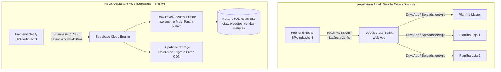
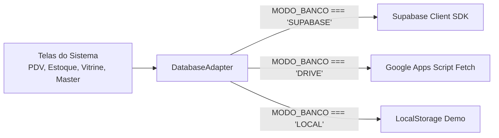

# 🚀 Planejamento Estratégico de Migração de Banco de Dados
## Do Google Drive / Google Sheets para Supabase (PostgreSQL Multi-Tenant)

> **Documento de Especificação Técnica & Roteiro de Execução**  
> **Sistema:** Clara Gestão (SaaS Multi-Lojas, PDV, Vitrine Online & Finanças)  
> **Status:** Aprovado para Execução em Fases  
> **Público-alvo deste documento:** Desenvolvedores, Engenheiros de Software e Agentes de IA em sessões futuras.

---

## 📑 Sumário

1. [Visão Geral & Contexto da Decisão](#1-visão-geral--contexto-da-decisão)
2. [Comparativo Arquitetural: Atual vs. Alvo](#2-comparativo-arquitetural-atual-vs-alvo)
3. [Hospedagem & Infraestrutura (Custo Zero)](#3-hospedagem--infraestrutura-custo-zero)
4. [Modelagem Relacional de Dados (DDL SQL Supabase)](#4-modelagem-relacional-de-dados-ddl-sql-supabase)
5. [Segurança & Isolamento Multi-Tenant (RLS - Row Level Security)](#5-segurança--isolamento-multi-tenant-rls---row-level-security)
6. [Motor de Métricas & Analytics da Vitrine Online](#6-motor-de-métricas--analytics-da-vitrine-online)
7. [Padrão de Adaptação no Frontend (Adapter Pattern)](#7-padrão-de-adaptação-no-frontend-adapter-pattern)
8. [Estratégia de Migração dos Dados Existentes (ETL)](#8-estratégia-de-migração-dos-dados-existentes-etl)
9. [Roadmap de Execução Dividido em 6 Fases](#9-roadmap-de-execução-dividido-em-6-fases)
10. [Instruções para a IA / Desenvolvedor na Próxima Sessão](#10-instruções-para-a-ia--desenvolvedor-na-próxima-sessão)

---

## 1. Visão Geral & Contexto da Decisão

### 1.1 Cenário Atual
O sistema **Clara Gestão** opera atualmente com:
- **Frontend SPA (Single Page Application):** HTML5, CSS3 (Tailwind + Custom) e JavaScript puro (`index.html`), hospedado estaticamente no **Netlify**.
- **Backend:** Google Apps Script (`google_apps_script.js`), atuando como Web App REST (`doGet` e `doPost`).
- **Banco de Dados:** Uma **Planilha Master** (`GESTÃO MASTER`) e uma **Planilha Dedicada** por loja dentro de pastas organizadas no **Google Drive** (`APP_CLARA_SISTEMA`).

### 1.2 Por que Migrar? (Gargalos do Google Sheets)
Embora a solução com Google Drive tenha custo zero e tenha sido excelente para validação de MVP (Produto Mínimo Viável):
1. **Latência de Requisições:** O Google Apps Script leva entre **1,5s a 4s** por chamada HTTP (cold start e processamento de planilhas).
2. **Concorrência e Conflitos:** O Google Sheets não possui controle transacional nativo (`ACID`). Múltiplas pessoas comprando simultaneamente no PDV ou vitrine podem gerar sobrescritas ou deadlocks de aba.
3. **Limitações de Cota do Google:**
   - 20.000 chamadas URL Fetch / dia;
   - 6 minutos de tempo máximo de execução por script;
   - Limite de 10 milhões de células por planilha.
4. **Inviabilidade para Métricas em Tempo Real:** Registrar cada visualização de produto ou adição de item ao carrinho em uma planilha causaria travamento por concorrência e lentidão extrema.
5. **Planos de Comercialização SaaS:** O proprietário planeja comercializar a plataforma para dezenas/centenas de lojistas (revendedoras de cosméticos/perfumaria, brechós, salões de beleza e varejo geral). Um banco de dados relacional de nível de produção é indispensável.

### 1.3 A Escolha do Supabase (PostgreSQL)
O **Supabase** foi selecionado após análise comparativa com Firebase Firestore e MongoDB Atlas:
- **Relacional & Transacional (PostgreSQL):** Perfeito para e-commerce e PDV (pedidos com múltiplos itens vinculados, cálculo de estoque atômico, integridade referencial com chaves estrangeiras).
- **Row Level Security (RLS) Nativo:** Regras de isolamento multi-tenant aplicadas diretamente no motor do banco. Uma loja física `LOJA-1` é tecnicamente incapaz de ler dados de `LOJA-2`.
- **SDK JavaScript Leve (`@supabase/supabase-js`):** Funciona diretamente no frontend Netlify via CDN ou import ES, sem necessidade de construir um servidor Node.js intermediário para operações padrão.
- **Suporte Robusto a Analytics / SQL Avançado:** Consultas com `GROUP BY`, `COUNT`, janelas de tempo e agregações para o futuro **Motor de Métricas da Vitrine Online**, sem pagar por documento lido como no Firestore.

---

## 2. Comparativo Arquitetural: Atual vs. Alvo



| Critério | Google Apps Script + Sheets | Supabase (PostgreSQL) | Ganho |
| :--- | :--- | :--- | :--- |
| **Tempo Médio de Resposta** | 1.800ms - 4.500ms | 40ms - 180ms | **~25x mais rápido** |
| **Integridade de Dados** | Nenhuma (linhas soltas de texto) | Chaves Estrangeiras, Tipos Estritos, Constraints | **Prevenção de corrupção** |
| **Transações (ACID)** | Inexistente (baixa simultânea pode falhar) | Total (`BEGIN ... COMMIT`) | **Zero inconsistência de estoque** |
| **Isolamento de Lojas** | 1 arquivo de planilha por loja | RLS (`WHERE loja_id = auth.uid()`) em 1 banco único | **Governança centralizada e simples** |
| **Métricas e Analytics** | Inviável registrar eventos rápidos | Inserções rápidas e agregação via SQL (`SUM`, `AVG`) | **Permite métricas completas da loja** |
| **Backup e Restauração** | Manual por cópia de arquivo | Backup automatizado point-in-time diário | **Segurança corporativa** |

---

## 3. Hospedagem & Infraestrutura (Custo Zero)

A nova arquitetura preserva a premissa de **custo operacional zero** na fase inicial e suporta escalabilidade conforme o produto comercial for crescendo:

### 3.1 Frontend: Netlify (Plano Starter Gratuito)
- **Custo:** R\$ 0,00 / mês.
- **Recursos:**
  - 100 GB de largura de banda mensal;
  - Deploy contínuo via GitHub (cada commit na branch `main` atualiza o site automaticamente);
  - Certificado SSL/HTTPS gratuito e renovação automática;
  - Distribuição global em CDN (Edge Network).

### 3.2 Banco de Dados & Storage: Supabase (Plano Free)
- **Custo:** R\$ 0,00 / mês.
- **Recursos Inclusos:**
  - 500 MB de armazenamento PostgreSQL (suficiente para ~100.000 produtos e vendas);
  - 50.000 usuários ativos mensais;
  - 1 GB de armazenamento de arquivos (Supabase Storage para logos e fotos de produtos);
  - 2 GB de transferência de saída;
  - API REST e Realtime geradas automaticamente a partir do schema;
  - Backups automáticos inclusos.

---

## 4. Modelagem Relacional de Dados (DDL SQL Supabase)

O script SQL abaixo deve ser executado no **SQL Editor** do Dashboard do Supabase. Ele cria a estrutura consolidada multi-tenant, índices de performance e triggers de auditoria:

```sql
-- ==============================================================================
-- CLARA GESTÃO - SCHEMA RELACIONAL MULTI-TENANT (SUPABASE POSTGRESQL)
-- ==============================================================================

-- Habilita extensão para geração de UUIDs
CREATE EXTENSION IF NOT EXISTS "uuid-ossp";

-- ------------------------------------------------------------------------------
-- 1. TABELA DE LOJAS (Multi-Tenancy Master)
-- ------------------------------------------------------------------------------
CREATE TABLE IF NOT EXISTS public.lojas (
    id TEXT PRIMARY KEY,                       -- Ex: 'LOJA-1', 'LOJA-2' ou UUID
    nome_loja TEXT NOT NULL,
    login TEXT UNIQUE NOT NULL,
    senha_hash TEXT NOT NULL,
    nome_responsavel TEXT,
    whatsapp TEXT,
    status TEXT NOT NULL DEFAULT 'Ativa' CHECK (status IN ('Ativa', 'Bloqueada')),
    created_at TIMESTAMPTZ DEFAULT NOW(),
    updated_at TIMESTAMPTZ DEFAULT NOW()
);

-- ------------------------------------------------------------------------------
-- 2. TABELA DE CONFIGURAÇÕES & IDENTIDADE VISUAL DA LOJA
-- ------------------------------------------------------------------------------
CREATE TABLE IF NOT EXISTS public.configuracoes_loja (
    loja_id TEXT PRIMARY KEY REFERENCES public.lojas(id) ON DELETE CASCADE,
    slogan TEXT DEFAULT 'Os melhores produtos com as melhores condições',
    cor_primaria TEXT DEFAULT '#2563EB',
    cor_destaque TEXT DEFAULT '#EF4444',
    cor_menu TEXT DEFAULT '#0F172A',
    cor_fundo TEXT DEFAULT '#F8FAFC',
    banner_ativo BOOLEAN DEFAULT FALSE,
    banner_texto TEXT DEFAULT '🎉 Super Ofertas da Semana! Aproveite enquanto durar o estoque.',
    logo_url TEXT DEFAULT '',
    chave_pix TEXT DEFAULT '',
    permite_delivery BOOLEAN DEFAULT TRUE,
    taxa_entrega NUMERIC(10,2) DEFAULT 0.00,
    modelo_parcelamento TEXT DEFAULT 'MODELO_1' CHECK (modelo_parcelamento IN ('MODELO_1', 'MODELO_2')),
    valor_minimo_parcela NUMERIC(10,2) DEFAULT 50.00,
    max_parcelas_geral INTEGER DEFAULT 6,
    tabela_faixas_json JSONB DEFAULT '[{"ateValor": 100, "maxParcelas": 1}, {"ateValor": 300, "maxParcelas": 3}, {"ateValor": 99999, "maxParcelas": 6}]'::jsonb,
    updated_at TIMESTAMPTZ DEFAULT NOW()
);

-- ------------------------------------------------------------------------------
-- 3. TABELA DE CLIENTES
-- ------------------------------------------------------------------------------
CREATE TABLE IF NOT EXISTS public.clientes (
    id TEXT PRIMARY KEY,                       -- Ex: 'CLI-XXXXXX'
    loja_id TEXT NOT NULL REFERENCES public.lojas(id) ON DELETE CASCADE,
    nome TEXT NOT NULL,
    telefone TEXT,
    endereco TEXT,
    documento TEXT,
    observacoes TEXT,
    created_at TIMESTAMPTZ DEFAULT NOW(),
    updated_at TIMESTAMPTZ DEFAULT NOW()
);

CREATE INDEX IF NOT EXISTS idx_clientes_loja ON public.clientes(loja_id);

-- ------------------------------------------------------------------------------
-- 4. TABELA DE PRODUTOS & SERVIÇOS (COM SUPORTE A NICHOS)
-- ------------------------------------------------------------------------------
CREATE TABLE IF NOT EXISTS public.produtos (
    id TEXT PRIMARY KEY,                       -- Ex: 'PROD-XXXXXX'
    loja_id TEXT NOT NULL REFERENCES public.lojas(id) ON DELETE CASCADE,
    nome TEXT NOT NULL,
    variacao TEXT DEFAULT '',
    codigo_barras TEXT DEFAULT '',
    categoria TEXT DEFAULT 'Geral',
    preco_custo NUMERIC(10,2) DEFAULT 0.00,
    margem_percentual NUMERIC(10,2) DEFAULT 0.00,
    preco_venda NUMERIC(10,2) NOT NULL DEFAULT 0.00,
    estoque_atual INTEGER NOT NULL DEFAULT 0,
    estoque_minimo INTEGER DEFAULT 2,
    foto_url TEXT DEFAULT '',
    visivel_online BOOLEAN DEFAULT TRUE,
    em_promocao BOOLEAN DEFAULT FALSE,
    preco_promocional NUMERIC(10,2) DEFAULT 0.00,
    destaque BOOLEAN DEFAULT FALSE,
    descricao TEXT DEFAULT '',
    somente_a_vista BOOLEAN DEFAULT FALSE,
    
    -- Atributos de Nicho (Perfumaria, Brechó, Salão de Beleza)
    tipo_item TEXT DEFAULT 'Produto Físico' CHECK (tipo_item IN ('Produto Físico', 'Serviço')),
    data_validade DATE,
    condicao_peca TEXT DEFAULT 'Não aplicável / Novo',
    medidas TEXT DEFAULT '',
    peca_unica BOOLEAN DEFAULT FALSE,
    consignante_nome TEXT DEFAULT '',
    consignante_comissao NUMERIC(5,2) DEFAULT 0.00,
    
    created_at TIMESTAMPTZ DEFAULT NOW(),
    updated_at TIMESTAMPTZ DEFAULT NOW()
);

CREATE INDEX IF NOT EXISTS idx_produtos_loja ON public.produtos(loja_id);
CREATE INDEX IF NOT EXISTS idx_produtos_visivel ON public.produtos(loja_id, visivel_online);

-- ------------------------------------------------------------------------------
-- 5. TABELA DE VENDAS & PEDIDOS
-- ------------------------------------------------------------------------------
CREATE TABLE IF NOT EXISTS public.vendas (
    id TEXT PRIMARY KEY,                       -- Ex: 'VEN-XXXXXX' ou 'PED-XXXXXX'
    loja_id TEXT NOT NULL REFERENCES public.lojas(id) ON DELETE CASCADE,
    tipo TEXT NOT NULL DEFAULT 'Venda PDV',     -- 'Venda PDV' ou 'Pedido Online'
    origem TEXT NOT NULL DEFAULT 'PDV',        -- 'PDV' ou 'Vitrine Online'
    cliente_id TEXT REFERENCES public.clientes(id) ON DELETE SET NULL,
    cliente_nome TEXT NOT NULL DEFAULT 'Cliente Balcão',
    cliente_telefone TEXT DEFAULT '',
    total_bruto NUMERIC(10,2) NOT NULL DEFAULT 0.00,
    taxa_entrega NUMERIC(10,2) DEFAULT 0.00,
    desconto NUMERIC(10,2) DEFAULT 0.00,
    total_liquido NUMERIC(10,2) NOT NULL DEFAULT 0.00,
    lucro_total NUMERIC(10,2) DEFAULT 0.00,
    forma_pagamento TEXT DEFAULT 'Dinheiro',
    condicao_pagamento TEXT DEFAULT 'A Vista',
    parcelas INTEGER DEFAULT 1,
    valor_parcela NUMERIC(10,2) DEFAULT 0.00,
    status_financeiro TEXT DEFAULT 'Pago' CHECK (status_financeiro IN ('Pago', 'Pendente', 'Parcial', 'Cancelada')),
    valor_pago NUMERIC(10,2) DEFAULT 0.00,
    saldo_devedor NUMERIC(10,2) DEFAULT 0.00,
    status_pedido TEXT DEFAULT 'Aprovado' CHECK (status_pedido IN ('Aprovado', 'Pendente', 'Cancelada', 'Entregue', 'Orçamento')),
    modalidade_entrega TEXT DEFAULT 'Retirada',
    endereco_entrega TEXT DEFAULT '',
    observacoes TEXT DEFAULT '',
    motivo_cancelamento TEXT DEFAULT '',
    data_vencimento DATE,
    profissional TEXT DEFAULT '',
    created_at TIMESTAMPTZ DEFAULT NOW(),
    updated_at TIMESTAMPTZ DEFAULT NOW()
);

CREATE INDEX IF NOT EXISTS idx_vendas_loja ON public.vendas(loja_id);
CREATE INDEX IF NOT EXISTS idx_vendas_data ON public.vendas(loja_id, created_at DESC);
CREATE INDEX IF NOT EXISTS idx_vendas_status ON public.vendas(loja_id, status_pedido, status_financeiro);

-- ------------------------------------------------------------------------------
-- 6. TABELA DE ITENS DA VENDA
-- ------------------------------------------------------------------------------
CREATE TABLE IF NOT EXISTS public.itens_venda (
    id_item TEXT PRIMARY KEY,                  -- Ex: 'ITEM-XXXXXX'
    venda_id TEXT NOT NULL REFERENCES public.vendas(id) ON DELETE CASCADE,
    loja_id TEXT NOT NULL REFERENCES public.lojas(id) ON DELETE CASCADE,
    produto_id TEXT REFERENCES public.produtos(id) ON DELETE SET NULL,
    produto_nome TEXT NOT NULL,
    variacao TEXT DEFAULT '',
    quantidade INTEGER NOT NULL DEFAULT 1,
    preco_custo_unitario NUMERIC(10,2) DEFAULT 0.00,
    preco_original NUMERIC(10,2) DEFAULT 0.00, -- Preço cheio de tabela
    desconto_unitario NUMERIC(10,2) DEFAULT 0.00,
    preco_venda_unitario NUMERIC(10,2) NOT NULL DEFAULT 0.00,
    subtotal NUMERIC(10,2) NOT NULL DEFAULT 0.00,
    lucro_item NUMERIC(10,2) DEFAULT 0.00,
    created_at TIMESTAMPTZ DEFAULT NOW()
);

CREATE INDEX IF NOT EXISTS idx_itens_venda ON public.itens_venda(venda_id);
CREATE INDEX IF NOT EXISTS idx_itens_loja ON public.itens_venda(loja_id);

-- ------------------------------------------------------------------------------
-- 7. TABELA DE DESPESAS & CUSTOS OPERACIONAIS
-- ------------------------------------------------------------------------------
CREATE TABLE IF NOT EXISTS public.despesas (
    id TEXT PRIMARY KEY,                       -- Ex: 'DESP-XXXXXX'
    loja_id TEXT NOT NULL REFERENCES public.lojas(id) ON DELETE CASCADE,
    descricao TEXT NOT NULL,
    categoria TEXT NOT NULL,
    valor NUMERIC(10,2) NOT NULL DEFAULT 0.00,
    data_despesa DATE NOT NULL DEFAULT CURRENT_DATE,
    observacoes TEXT DEFAULT '',
    created_at TIMESTAMPTZ DEFAULT NOW()
);

CREATE INDEX IF NOT EXISTS idx_despesas_loja ON public.despesas(loja_id);
CREATE INDEX IF NOT EXISTS idx_despesas_data ON public.despesas(loja_id, data_despesa DESC);

-- ------------------------------------------------------------------------------
-- 8. TABELA DO MOTOR DE MÉTRICAS & TELEMETRIA DA VITRINE ONLINE
-- ------------------------------------------------------------------------------
CREATE TABLE IF NOT EXISTS public.metricas_eventos (
    id BIGSERIAL PRIMARY KEY,
    loja_id TEXT NOT NULL REFERENCES public.lojas(id) ON DELETE CASCADE,
    session_id TEXT NOT NULL,                  -- UUID anônimo salvo no sessionStorage do visitante
    evento TEXT NOT NULL CHECK (evento IN (
        'loja_aberta', 
        'produto_visualizado', 
        'produto_adicionado_sacola', 
        'produto_removido_sacola', 
        'sacola_aberta', 
        'checkout_iniciado', 
        'checkout_concluido_whatsapp'
    )),
    produto_id TEXT REFERENCES public.produtos(id) ON DELETE SET NULL,
    produto_nome TEXT,
    categoria TEXT,
    quantidade INTEGER DEFAULT 1,
    valor NUMERIC(10,2) DEFAULT 0.00,
    dispositivo TEXT DEFAULT 'mobile',         -- 'mobile', 'desktop', 'tablet'
    created_at TIMESTAMPTZ DEFAULT NOW()
);

CREATE INDEX IF NOT EXISTS idx_metricas_loja_data ON public.metricas_eventos(loja_id, created_at DESC);
CREATE INDEX IF NOT EXISTS idx_metricas_evento ON public.metricas_eventos(loja_id, evento);
CREATE INDEX IF NOT EXISTS idx_metricas_produto ON public.metricas_eventos(loja_id, produto_id);

-- ------------------------------------------------------------------------------
-- 9. FUNÇÃO E TRIGGER PARA ATUALIZAÇÃO AUTOMÁTICA DE updated_at
-- ------------------------------------------------------------------------------
CREATE OR REPLACE FUNCTION public.handle_updated_at()
RETURNS TRIGGER AS $$
BEGIN
    NEW.updated_at = NOW();
    RETURN NEW;
END;
$$ LANGUAGE plpgsql;

CREATE TRIGGER tg_lojas_updated_at BEFORE UPDATE ON public.lojas FOR EACH ROW EXECUTE FUNCTION public.handle_updated_at();
CREATE TRIGGER tg_produtos_updated_at BEFORE UPDATE ON public.produtos FOR EACH ROW EXECUTE FUNCTION public.handle_updated_at();
CREATE TRIGGER tg_clientes_updated_at BEFORE UPDATE ON public.clientes FOR EACH ROW EXECUTE FUNCTION public.handle_updated_at();
CREATE TRIGGER tg_vendas_updated_at BEFORE UPDATE ON public.vendas FOR EACH ROW EXECUTE FUNCTION public.handle_updated_at();
CREATE TRIGGER tg_config_updated_at BEFORE UPDATE ON public.configuracoes_loja FOR EACH ROW EXECUTE FUNCTION public.handle_updated_at();
```

---

## 5. Segurança & Isolamento Multi-Tenant (RLS - Row Level Security)

O Supabase possui suporte nativo a **Row Level Security (RLS)**, garantindo que mesmo se alguém inspecionar as chamadas de rede no navegador, **uma loja jamais conseguirá consultar ou alterar registros de outra loja**.

### 5.1 Estratégia de Acesso e Autenticação

Para o modelo atual do frontend (que usa uma chave pública anônima `anon_key` com autenticação por credencial da loja):

1. **Vitrine Online Pública (Sem Login):**
   - Leitura liberada para catálogo de produtos (`visivel_online = true`) e configurações da loja especificada no parâmetro `?loja=...`.
   - Inserção liberada na tabela `metricas_eventos` (telemetria da vitrine) e pedidos online (`vendas`).
2. **Painel do Lojista (Autenticado):**
   - Usuário envia o token de autenticação ou cabeçalho de sessão contendo o `loja_id`.
   - RLS filtra rigorosamente: `WHERE loja_id = current_setting('request.headers', true)::json->>'x-loja-id'` ou JWT autenticado.
3. **Painel Master (Super Admin):**
   - Utiliza a chave com privilégios administrativos (`service_role` protegida) ou usuário com role `admin` no Supabase Auth.

```sql
-- Habilita RLS em todas as tabelas
ALTER TABLE public.lojas ENABLE ROW LEVEL SECURITY;
ALTER TABLE public.configuracoes_loja ENABLE ROW LEVEL SECURITY;
ALTER TABLE public.produtos ENABLE ROW LEVEL SECURITY;
ALTER TABLE public.clientes ENABLE ROW LEVEL SECURITY;
ALTER TABLE public.vendas ENABLE ROW LEVEL SECURITY;
ALTER TABLE public.itens_venda ENABLE ROW LEVEL SECURITY;
ALTER TABLE public.despesas ENABLE ROW LEVEL SECURITY;
ALTER TABLE public.metricas_eventos ENABLE ROW LEVEL SECURITY;

-- Política 1: Vitrine pública pode ler produtos visíveis
CREATE POLICY "Vitrine Online - Leitura de Produtos Ativos"
ON public.produtos FOR SELECT
USING (visivel_online = true);

-- Política 2: Vitrine pública pode ler configurações visuais da loja
CREATE POLICY "Vitrine Online - Leitura de Configurações"
ON public.configuracoes_loja FOR SELECT
USING (true);

-- Política 3: Vitrine pública pode registrar telemetria anônima
CREATE POLICY "Vitrine Online - Inserção de Métricas"
ON public.metricas_eventos FOR INSERT
WITH CHECK (true);

-- Política 4: Vitrine pública pode enviar pedidos online
CREATE POLICY "Vitrine Online - Envio de Pedidos"
ON public.vendas FOR INSERT
WITH CHECK (origem = 'Vitrine Online');

CREATE POLICY "Vitrine Online - Envio de Itens de Pedido"
ON public.itens_venda FOR INSERT
WITH CHECK (true);
```

---

## 6. Motor de Métricas & Analytics da Vitrine Online

Um dos grandes objetivos da migração é permitir ao lojista saber exatamente o que acontece na sua loja online. Criamos **Views SQL Analíticas** que calculam as métricas instantaneamente sem sobrecarregar o cliente:

### 6.1 View de Resumo Geral da Vitrine (`vw_metricas_vitrine_resumo`)
Mostra: Total de visitas únicas, produtos visualizados, produtos colocados na sacola e pedidos gerados.

```sql
CREATE OR REPLACE VIEW public.vw_metricas_vitrine_resumo AS
SELECT 
    loja_id,
    DATE(created_at) as data_referencia,
    COUNT(DISTINCT session_id) FILTER (WHERE evento = 'loja_aberta') as visitantes_unicos,
    COUNT(1) FILTER (WHERE evento = 'produto_visualizado') as total_visualizacoes_produtos,
    COUNT(1) FILTER (WHERE evento = 'produto_adicionado_sacola') as total_adicoes_sacola,
    COUNT(1) FILTER (WHERE evento = 'checkout_concluido_whatsapp') as pedidos_whatsapp_concluidos,
    CASE 
        WHEN COUNT(DISTINCT session_id) FILTER (WHERE evento = 'loja_aberta') > 0 
        THEN ROUND(
            (COUNT(1) FILTER (WHERE evento = 'checkout_concluido_whatsapp')::NUMERIC / 
             COUNT(DISTINCT session_id) FILTER (WHERE evento = 'loja_aberta')::NUMERIC) * 100, 2
        )
        ELSE 0.00 
    END as taxa_conversao_percentual
FROM public.metricas_eventos
GROUP BY loja_id, DATE(created_at);
```

### 6.2 View dos Produtos Mais Desejados / Adicionados na Sacola (`vw_top_produtos_sacola`)
Identifica itens com alta intenção de compra (adicionados à sacola):

```sql
CREATE OR REPLACE VIEW public.vw_top_produtos_sacola AS
SELECT 
    loja_id,
    produto_id,
    produto_nome,
    COUNT(1) as vezes_adicionado_sacola,
    SUM(quantidade) as quantidade_total_itens_sacola,
    COUNT(1) FILTER (WHERE evento = 'checkout_concluido_whatsapp') as vezes_comprado
FROM public.metricas_eventos
WHERE evento IN ('produto_adicionado_sacola', 'checkout_concluido_whatsapp')
GROUP BY loja_id, produto_id, produto_nome
ORDER BY vezes_adicionado_sacola DESC;
```

### 6.3 O Que Isso Permite no Dashboard do Lojista:
1. **Funil de Vendas da Vitrine:**  
   `Visitantes Únicos` $\rightarrow$ `Viraram Sacola` $\rightarrow$ `Finalizaram no WhatsApp`.
2. **Produtos "Quase Comprados" (Carrinhos Abandonados):**  
   Alerta para o lojista: *"O Perfume X foi adicionado 14 vezes na sacola esta semana mas só teve 2 pedidos. Deseja criar uma promoção?"*
3. **Pico de Horários de Visita:**  
   Descobrir se as clientes acessam mais de manhã, à tarde ou de noite para planejar disparos de mensagens e postagens no Instagram.

---

## 7. Padrão de Adaptação no Frontend (Adapter Pattern)

Para que a migração não quebre o sistema em produção nem cause interrupções, adotaremos o **Padrão Adapter** (`DatabaseAdapter`).

### 7.1 Como Funciona a Camada de Abstração
No arquivo [`index.html`](file:///c:/Users/victo/OneDrive/Documentos/GitHub/App-Gestao/index.html), atualmente as chamadas de rede utilizam `fetch(API_URL, ...)` diretamente. Substituiremos essas chamadas por métodos universais:



### 7.2 Interface do Adapter (`dbAdapter.js` ou integrado no `index.html`)

```javascript
const DatabaseAdapter = {
  // Configuração ativa
  provedorAtivo: "SUPABASE", // ou 'DRIVE', 'LOCAL'

  // Métodos de Produtos
  async listarProdutos(lojaId) {
    if (this.provedorAtivo === "SUPABASE") {
      const { data, error } = await supabaseClient
        .from("produtos")
        .select("*")
        .eq("loja_id", lojaId);
      if (error) throw error;
      return data;
    } else {
      return await chamadaGoogleAppsScript({ acao: "getDadosLoja", lojaId });
    }
  },

  // Métodos de Vendas
  async registrarVenda(lojaId, dadosVenda) {
    if (this.provedorAtivo === "SUPABASE") {
      // 1. Inserir cabeçalho da venda
      // 2. Inserir itens vinculados
      // 3. Decrementar estoque atômico
    } else {
      return await chamadaGoogleAppsScript({ acao: "registrarVenda", lojaId, venda: dadosVenda });
    }
  },

  // Telemetria da Vitrine
  async registrarMetrica(evento) {
    if (this.provedorAtivo === "SUPABASE") {
      await supabaseClient.from("metricas_eventos").insert([evento]);
    }
  }
};
```

---

## 8. Estratégia de Migração dos Dados Existentes (ETL)

Como já existem 2 lojas cadastradas em teste (`Mary Variedades` e outra loja) com produtos e configurações no Google Sheets:

### 8.1 Passo a Passo do Processo de Extração e Carga:
1. **Exportação (Extrator JSON):**  
   Utilizaremos o endpoint existente `getDadosMaster` e `getDadosLoja` do Google Apps Script para exportar o snapshot completo dos dados atuais em formato JSON limpo.
2. **Transformação & Limpeza:**  
   Mapear os nomes das colunas legadas em português com sublinhado (`Preco_Venda`, `Estoque_Atual`) para as colunas padronizadas em snake_case do Postgres (`preco_venda`, `estoque_atual`).
3. **Carga no Supabase (Seed Script):**  
   Um script de carga executará o `INSERT` ou `UPSERT` das lojas e seus respectivos produtos no Supabase.

---

## 9. Roadmap de Execução Dividido em 6 Fases

O projeto será executado estritamente de forma gradual para garantir estabilidade:

### 🟩 Fase 1: Setup da Infraestrutura Supabase & Criação de Tabelas
- [ ] Criar projeto gratuito no Supabase (`clara-gestao`);
- [ ] Executar o script DDL SQL completo no SQL Editor;
- [ ] Obter as chaves de API: `SUPABASE_URL` e `SUPABASE_ANON_KEY`;
- [ ] Configurar políticas de Row Level Security (RLS) básicas.

### 🟩 Fase 2: Implementação da Camada Adapter no Frontend
- [ ] Importar o SDK oficial `@supabase/supabase-js` no `<head>` do `index.html` via CDN;
- [ ] Criar o objeto `DatabaseAdapter` no JavaScript;
- [ ] Criar flag de chave seletora no Painel Master (`Provedor de Banco de Dados: [Google Drive | Supabase]`);
- [ ] Garantir que o sistema continua 100% funcional no modo atual (Google Drive) sem regressões.

### 🟩 Fase 3: Migração dos Dados Existentes (ETL)
- [ ] Executar script de extração das 2 lojas de teste do Google Drive;
- [ ] Importar lojas, configurações e produtos no Supabase;
- [ ] Validar contagem de itens e integridade dos preços e estoques.

### 🟩 Fase 4: Chaveamento da Vitrine Online Pública & Telemetria
- [ ] Atualizar o carregamento da Vitrine Online (`carregarDadosVitrineOnline`) para consumir via Supabase;
- [ ] Implementar os disparos de telemetria em segundo plano:
  - Ao carregar vitrine $\rightarrow$ `loja_aberta`;
  - Ao abrir modal de produto $\rightarrow$ `produto_visualizado`;
  - Ao clicar em "Adicionar à Sacola" $\rightarrow$ `produto_adicionado_sacola`;
  - Ao clicar em "Finalizar no WhatsApp" $\rightarrow$ `checkout_concluido_whatsapp`;
- [ ] Testar velocidade de carregamento da vitrine (esperado: < 300ms).

### 🟩 Fase 5: Migração do PDV, Vendas, Estoque e Finanças
- [ ] Migrar rotinas de inserção de venda e baixa de estoque para transação no Supabase;
- [ ] Migrar rotinas de cancelamento de venda com estorno de estoque;
- [ ] Migrar módulo de Despesas e Clientes;
- [ ] Criar no Dashboard do Lojista a nova aba **"📊 Métricas da Vitrine Online"** consumindo a View SQL.

### 🟩 Fase 6: Homologação Final, Painel Master & Desativação do Sheets
- [ ] Migrar telas do Painel Master (criação e edição de lojas, bloqueio de acesso);
- [ ] Executar bateria de testes automatizados completa com Microsoft Edge Headless;
- [ ] Realizar backup final de segurança das planilhas do Google Drive;
- [ ] Atualizar `README.md` e `HISTORICO_ALTERACOES.md` com a versão v4.0.0.

---

## 10. Instruções para a IA / Desenvolvedor na Próxima Sessão

> [!IMPORTANT]
> **Como retomar este projeto em uma nova sessão:**
> 1. Leia primeiro este arquivo (`PLANEJAMENTO_MIGRACAO_BANCO.md`) para compreender a arquitetura e as decisões tomadas.
> 2. Verifique com o usuário se ele já criou a conta e o projeto no [Supabase](https://supabase.com).
> 3. Peça a `SUPABASE_URL` e a `SUPABASE_ANON_KEY` para iniciar a **Fase 1 e Fase 2**.
> 4. Nunca remova o código legado do Google Apps Script de forma abrupta; mantenha o **DatabaseAdapter** comutável para garantir rollback instantâneo caso necessário.
> 5. Respeite as regras de negócio de nicho:
>    - Perfumaria: Validade de lotes e alertas visuais;
>    - Brechó: Peça única (estoque 1 travado), medidas reais em cm, comissões de consignação;
>    - Salão de Beleza: Tipo de item Produto Físico vs. Serviço;
>    - Preços: Termo "Preço" para item unitário e "Subtotal" para totais (nunca use "preço cheio").

