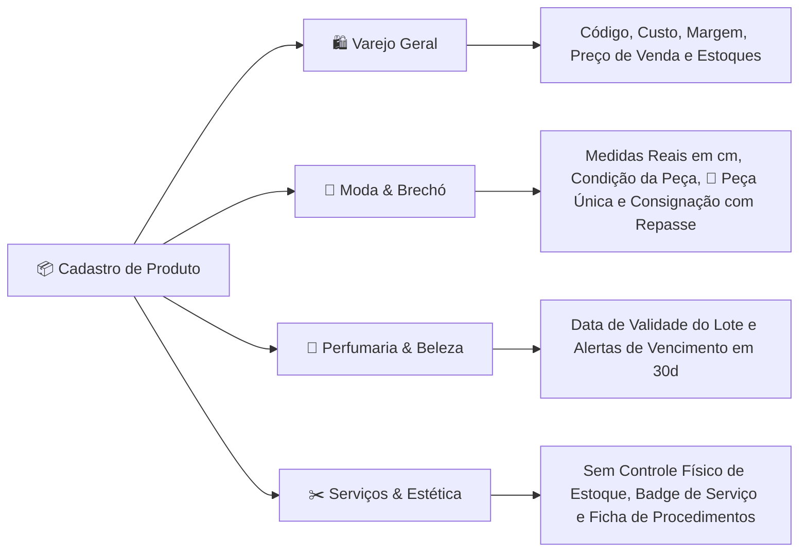

# 🛍️ Gestão Multi-lojas e E-Commerce

> Sistema web moderno de gestão empresarial multi-tenant, ponto de venda (PDV) ágil, vitrine online pública para clientes e controle financeiro integrado com backend em **Supabase (PostgreSQL Relacional)**, **Supabase Storage CDN** e notificações em tempo real via **Telegram Bot API**.

---

## 📑 Sumário

- [Visão Geral](#-visão-geral)
- [Nichos de Negócio Atendidos](#-nichos-de-negócio-atendidos)
- [Arquitetura do Ecossistema](#-arquitetura-do-ecossistema)
- [Módulos & Funcionalidades](#-módulos--funcionalidades)
  - [1. Painel Master (Super Admin)](#1-painel-master-super-admin)
  - [2. Painel do Lojista (Gestão Completa)](#2-painel-do-lojista-gestão-completa)
  - [3. Loja Online Pública (E-Commerce para Clientes)](#3-loja-online-pública-e-commerce-para-clientes)
  - [4. Design System & Acessibilidade (WCAG 2.1 AA)](#4-design-system--acessibilidade-wcag-21-aa)
  - [5. Blindagem de Segurança (OWASP Top 10 & LGPD)](#5-blindagem-de-segurança-owasp-top-10--lgpd)
- [Estrutura de Arquivos](#-estrutura-de-arquivos)
- [Como Configurar e Usar](#-como-configurar-e-usar)
  - [1. Execução Local (Frontend)](#1-execução-local-frontend)
  - [2. Configuração do Supabase & Scripts SQL](#2-configuração-do-supabase--scripts-sql)
  - [3. Notificações Automáticas no Telegram](#3-notificações-automáticas-no-telegram)
- [Credenciais Padrão de Acesso](#-credenciais-de-acesso)
- [Tecnologias Utilizadas](#-tecnologias-utilizadas)
- [Histórico de Versões](#-histórico-de-versões)

---

## 🌟 Visão Geral

A plataforma **Gestão Multi-lojas e E-Commerce** foi concebida como uma solução **Multi-Tenant (SaaS)** de alto desempenho e resiliência, permitindo operar e gerenciar múltiplas lojas independentes a partir de um único painel administrativo central (**Painel Master**), ao mesmo tempo em que disponibiliza para cada lojista seu painel de controle operacional e sua respectiva vitrine digital pública.

### Destaques da Plataforma (v4.5.5):
- **Execução Leve e Direta:** Single Page Application (SPA) pura em arquivo único ([index.html](file:///c:/Users/victo/OneDrive/Documentos/GitHub/App-Gestao-Supabase/index.html)), executável diretamente em qualquer navegador moderno sem necessidade de compilação, Node.js ou servidores locais.
- **Backend Relacional em Nuvem:** Integração nativa com **Supabase (PostgreSQL)** com isolamento multi-tenant, transações ACID para vendas e estoque, e CDN global para mídia no **Supabase Storage** (`arquivos-lojas`).
- **Design System "O Balcão Moderno":** Documentado formalmente em [DESIGN.md](file:///c:/Users/victo/OneDrive/Documentos/GitHub/App-Gestao-Supabase/DESIGN.md) e sincronizado com o sidecar `.impeccable/design.json`, oferecendo tipografia *Plus Jakarta Sans*, numerais tabulares (`tnum`), micro-interações táteis e acessibilidade WAI-ARIA com conformidade **WCAG 2.1 AA**.
- **Guarda Dinâmica de Contraste:** Cálculo algorítmico de luminância relativa ($L > 0.35$) que assegura legibilidade máxima em menus, botões e cabeçalhos independentemente da cor da marca escolhida pelo lojista.
- **Blindagem OWASP Top 10:** Sanitização universal contra Stored XSS (`escapeHtml`), políticas estritas de Row Level Security (RLS) idempotentes em [sql/security_hardening.sql](file:///c:/Users/victo/OneDrive/Documentos/GitHub/App-Gestao-Supabase/sql/security_hardening.sql), revalidação canônica de preços no checkout e autenticação offline com hash criptográfico SHA-256.
- **Mensageria Dupla:** Envio de pedidos pelo cliente final via WhatsApp (`wa.me`) e notificações automatizadas instantâneas no Telegram (`api.telegram.org`) para pedidos online, vendas no PDV e cancelamentos com estorno.

---

## 🎯 Nichos de Negócio Atendidos

O sistema implementa o padrão de **Descoberta Progressiva** com abas dinâmicas no cadastro de produtos, exibindo apenas os campos necessários para o segmento escolhido:



1. **Vestuário, Acessórios e Varejo Geral:**
   - Controle de variações de cor e tamanho, leitor de código de barras por webcam/câmera, cálculo de margem e markup reversos.
2. **Moda Circular & Brechós:**
   - Classificação por **Condição da Peça** (*Novo com etiqueta*, *Seminovo impecável*, *Usado bom estado*, *Vintage/Raridade*, *Customizado/Upcycling*);
   - **Medidas Reais em cm** (Busto, cintura, quadril, comprimento, ombro);
   - Flag de **💎 Peça Única** que trava o estoque em 1 un e estampa badge de destaque na vitrine;
   - Gestão de **Consignação** com controle de Consignante e percentual de comissão de repasse.
3. **Perfumaria & Cosméticos:**
   - Controle de **Data de Validade do Lote** no cadastro;
   - Monitoramento visual automático de vencimento no Estoque e no Dashboard (alertas com status para itens vencidos ou vencendo em até 30 dias);
   - Ficha do cliente com histórico de preferências olfativas, tom de base e tipo de pele.
4. **Salões de Beleza & Clínicas de Estética:**
   - Conversão inteligente de tipo de item (**Produto Físico vs. Serviço**);
   - Dispensa de controle de estoque físico com estoque virtual (999 un) e identificação `✂️ Serviço`;
   - Ficha de histórico técnico de procedimentos químicos, tratamentos e cortes.

---

## 🏛️ Arquitetura do Ecossistema

```mermaid
flowchart TD
    subgraph Frontend ["💻 Frontend Web (SPA - Single Page Application)"]
        M[👑 Super Administrador<br>Painel Master]
        L[🏪 Lojista<br>Dashboard, PDV, Estoque, Cobrança, Despesas]
        V[🛍️ Vitrine Pública do Cliente<br>?loja=ID]
    end

    subgraph Backend ["⚡ Supabase Cloud Platform"]
        subgraph Postgres ["🐘 PostgreSQL Relacional Multi-Tenant"]
            TL[Tabela: public.lojas]
            TC[Tabela: public.configuracoes_loja]
            TP[Tabela: public.produtos]
            TV[Tabela: public.vendas & itens_venda]
            TD[Tabela: public.despesas & clientes]
            TM[Tabela: public.metricas_eventos]
            TCP[Tabela: public.configuracoes_plataforma]
            RPC["Stored Procedures ACID<br>(autenticar_usuario, registrar_venda_completa)"]
        end

        subgraph Storage ["📦 Supabase Storage"]
            B[Bucket: arquivos-lojas<br>Logotipos & Fotos de Produtos CDN]
        end
    end

    subgraph Integracoes ["📡 Integrações de Mensageria Externa"]
        TG[🤖 Telegram Bot API<br>Notificações Instantâneas]
        WP[📱 WhatsApp API / wa.me<br>Envio do Pedido do Cliente]
    end

    M <-->|"REST API / RPC"| Postgres
    L <-->|"REST API / RPC"| Postgres
    V -->|"Catálogo Público (RLS)"| TP
    V -->|"Checkout Pendente (Auditoria Canônica)"| TV
    V -->|"Telemetria de Sacola"| TM
    L <-->|"Upload / Leitura"| Storage
    V -->|"CDN Rápida de Imagens"| Storage
    V -->|"Disparo de Pedido"| WP
    L -.->|"Notificação Automática"| TG
    V -.->|"Alerta de Novo Pedido"| TG
```



---

## 📦 Módulos & Funcionalidades

### 1. Painel Master (Super Admin)
- **Isolamento de Identidade Visual (`CORES_PADRAO_MASTER`):** Tema fixo em azul royal (`#2563EB`) e ardósia (`#0F172A`) imune à contaminação por paletas de cores customizadas de lojas individuais;
- **Faturamento e Gestão Global:** Indicadores consolidados de faturamento, total de produtos e carteira a receber de todas as lojas;
- **Busca e Filtro em Tempo Real:** Pesquisa instantânea por nome, responsável ou ID, além de filtro por status (*Todas*, *Ativas*, *Bloqueadas*);
- **Criação e Gestão de Lojas:** Cadastro com provisionamento imediato no Supabase;
- **Visualização Detalhada da Loja (`#modalVerLojaMaster`):** Métricas, login, status, link público da vitrine e atalho para WhatsApp;
- **Login como Lojista (*Impersonation*):** Permite ao super admin assumir o painel de qualquer loja com um clique e retornar ao Master com facilidade;
- **Gestão do Bot Central do Telegram:** Configuração do `@username` e do token da plataforma para envio compartilhado de notificações.

### 2. Painel do Lojista (Gestão Completa)
- **Dashboard Estratégico:**
  - 5 cartões com numerais tabulares: *Vendas Hoje*, *Vendas no Mês*, *A Receber*, *Despesas do Mês* e *Lucro Líquido Real*;
  - Apuração exata do Lucro Líquido Real:
    $$\text{Lucro Líquido} = \text{Faturamento Líquido} - \text{CMV} - \text{Despesas Operacionais}$$
  - Gráficos in-place com Chart.js sem recriações de canvas e telemetria de intenções de sacola;
  - Banners automáticos de reposição de estoque crítico e vencimento de lotes.
- **PDV / Caixa Rápido com Atalhos de Teclado:**
  - Atalhos operacionais de alta produtividade:
    - `/` $\rightarrow$ Foca o campo de busca de produtos;
    - `F2` $\rightarrow$ Limpa o carrinho de compras (com confirmação defensiva se houver itens);
    - `F4` $\rightarrow$ Finaliza a venda imediatamente;
    - `1`, `2`, `3`, `4` $\rightarrow$ Seleção rápida de Dinheiro, Pix, Cartão de Crédito ou Débito;
    - `Esc` $\rightarrow$ Fecha imediatamente qualquer modal ou gaveta lateral aberta.
  - **Detector Visual de Inadimplência:** Identificação em destaque `⚠️ [Nome] (Deve R$ XX,XX)` no seletor de clientes e banner de alerta no carrinho com atalho `Ver Contas` para consultar pendências antes de conceder novo crédito a prazo;
  - Leitor de código de barras por câmera/webcam com busca instantânea;
  - Impressão de recibo e cupom térmico (58mm/80mm) ou papel A4 com visual padronizado.
- **Gestão de Estoque com Abas de Nicho:**
  - Formulário com segmentação visual (*Varejo*, *Moda*, *Perfumaria*, *Serviços*);
  - Calculadora de Preço: Preço Custo $\rightarrow$ Markup (%) $\rightarrow$ Preço Venda;
  - Trava de pagamento exclusivo à vista para peças em promoção;
  - Confirmação defensiva com SweetAlert2 para prevenir exclusão acidental de produtos (`excluirProduto`);
  - Exportação da base de produtos em CSV formatado para Excel.
- **Vendas & Contas a Receber:**
  - Listagem unificada de vendas do PDV e pedidos da loja online com suporte a rolagem horizontal em smartphones;
  - Visualização de itens e detalhes da venda (`#modalDetalhesVenda`);
  - **Cancelamento com Auditoria:** Registro obrigatório do motivo e estorno automático das peças para o estoque via procedure ACID;
  - **Cobrança Humanizada no WhatsApp:** Mensagem pré-formatada com saldo pendente, vencimento e chave Pix da loja.
- **Histórico Completo do Cliente:**
  - Ficha financeira individual com filtros rápidos de período (*Hoje*, *7 dias*, *Mês*, *Todas*) e status (*Quitadas*, *Pendentes*, *Canceladas*);
  - Atribuição simplificada de pedidos online avulsos a cadastros de clientes existentes.
- **Módulo de Despesas & Fluxo de Caixa:**
  - Tela dedicada (`#tela-despesas`) com filtros por categoria e mês/ano de apuração;
  - Categorias pré-configuradas: Aluguel, Energia/Água, Embalagens, Marketing/Anúncios, Salários/Retiradas, Repasses de Consignação e Outros.
- **Customização de Marca & E-Commerce:**
  - Paleta livre com seletor hexadecimal e aplicação em tempo real com evento `oninput`;
  - Cálculo de contraste normativo ($L > 0.35$) ajustando automaticamente textos entre branco e ardósia escuro;
  - Upload de logotipo com CDN no Supabase Storage e banners promocionais;
  - Modelos de parcelamento: Valor mínimo por parcela ou tabela de faixas fixas personalizável;
  - Configuração de notificações automáticas via Telegram Bot com botão de teste imediato.

### 3. Loja Online Pública (E-Commerce para Clientes)
- Acessível por link direto (`?loja=ID` ou `?loja=login`), **sem necessidade de login ou senha do cliente**;
- Design responsivo adaptativo com respeito à paleta da marca e proteção de contraste;
- **Gestão Completa da Sacola de Compras:**
  - Steppers de ajuste de quantidade `(-)` e `(+)` direto no modal do carrinho;
  - Exclusão unitária rápida (`trash-2`);
  - Limpeza total com confirmação protetiva para evitar descarte acidental de pedidos montados;
  - Empty states ilustrados e humanizados quando a sacola estiver vazia.
- **Proteção contra Adulteração de Preços (SEC-04):** Revalidação canônica obrigatória de todos os preços, promoções e subtotais contra o catálogo oficial `loja.produtos` antes da gravação do pedido;
- **Checkout com WhatsApp & Telegram:** Geração de mensagem estruturada para envio no WhatsApp do lojista e despacho simultâneo e assíncrono para o bot do Telegram da loja.

### 4. Design System & Acessibilidade (WCAG 2.1 AA)
- **Identidade "O Balcão Moderno":** Especificada em [DESIGN.md](file:///c:/Users/victo/OneDrive/Documentos/GitHub/App-Gestao-Supabase/DESIGN.md) com princípios de agilidade, clareza e solidez visual;
- **Tipografia:** Fonte *Plus Jakarta Sans* com proporções calibradas e numerais tabulares (`tabular-nums`);
- **Semântica WAI-ARIA:** Atributos normativos (`role="tablist"`, `role="tab"`, `aria-selected`, `aria-controls`, `role="tabpanel"`) para navegação inclusiva por leitores de tela;
- **Navegação por Teclado:** Anéis de foco nítidos (`:focus-visible`) e tecla `Esc` global;
- **Responsividade Mobile Guard:** Proteção `pb-24` contra sobreposição da barra de navegação inferior móvel (`#mobileBottomNav`) e rolagem horizontal suave em todas as tabelas.

### 5. Blindagem de Segurança (OWASP Top 10 & LGPD)
- **SEC-01 (Stored XSS):** Higienização de todas as saídas dinâmicas no DOM com `escapeHtml()` nativo;
- **SEC-02 (Supabase RLS):** Políticas de Row Level Security estritas e 100% idempotentes com limpeza dinâmica de regras legadas em [sql/security_hardening.sql](file:///c:/Users/victo/OneDrive/Documentos/GitHub/App-Gestao-Supabase/sql/security_hardening.sql);
- **SEC-03 (Autenticação Offline Segura):** Remoção de senhas fracas hardcoded; o fallback offline exige validação contra hash SHA-256 armazenado localmente;
- **SEC-04 (Auditoria de Preços no Checkout):** Bloqueio de manipulação de preços em memória ou console do cliente;
- **SEC-05 & SEC-06 (Integridade & Headers):** Fixação de CDN Lucide `0.460.0` e meta-tags HTTP `X-Content-Type-Options: nosniff` e `Referrer-Policy: strict-origin-when-cross-origin`;
- **LGPD:** Termos de privacidade no checkout e exclusão definitiva de clientes (Direito ao Esquecimento - Art. 18).

---

## 📁 Estrutura de Arquivos

```text
App-Gestao-Supabase/
├── index.html                      # Aplicação Web SPA completa (Painéis, PDV e Vitrine Pública)
├── README.md                       # Documentação oficial e guia do ecossistema
├── HISTORICO_ALTERACOES.md         # Registro cronológico detalhado de versões (Changelog)
├── DESIGN.md                       # Especificação canônica do Design System ("O Balcão Moderno")
├── PRODUCT.md                      # Especificação do produto, personas e casos de uso
├── sql/                            # Scripts SQL para PostgreSQL e Supabase
│   ├── security_hardening.sql      # Script de blindagem OWASP e políticas RLS idempotentes
│   ├── telegram_notifications.sql  # Migração de campos de notificação do Telegram
│   └── configuracoes_plataforma.sql# Provisionamento da tabela global e Bot Central
└── docs/                           # Documentações técnicas de arquitetura
    └── PLANEJAMENTO_MIGRACAO_BANCO.md # Documentação da migração relacional
```

---

## 🚀 Como Configurar e Usar

### 1. Execução Local (Frontend)
Não requer instalação de Node.js, compilação ou gerenciadores de pacotes:
1. Abra o arquivo [`index.html`](file:///c:/Users/victo/OneDrive/Documentos/GitHub/App-Gestao-Supabase/index.html) diretamente no Google Chrome, Microsoft Edge ou em qualquer navegador moderno;
2. A aplicação carrega os recursos necessários via CDN e conecta-se diretamente ao Supabase.

### 2. Configuração do Supabase & Scripts SQL
No painel do seu projeto no [Supabase Dashboard](https://supabase.com/dashboard) $\rightarrow$ **SQL Editor**:

1. **Blindagem de Segurança e Políticas RLS:**
   - Execute o script [`sql/security_hardening.sql`](file:///c:/Users/victo/OneDrive/Documentos/GitHub/App-Gestao-Supabase/sql/security_hardening.sql);
   - O script remove dinamicamente políticas antigas conflitantes, ativa o Row Level Security em todas as tabelas e protege a coluna `senha_hash`.
2. **Notificações Automáticas no Telegram (Opcional):**
   - Execute o script [`sql/telegram_notifications.sql`](file:///c:/Users/victo/OneDrive/Documentos/GitHub/App-Gestao-Supabase/sql/telegram_notifications.sql);
   - Ele adiciona as colunas de integração na tabela `configuracoes_loja`.
3. **Bot Central da Plataforma (Opcional para Modo SaaS):**
   - Execute o script [`sql/configuracoes_plataforma.sql`](file:///c:/Users/victo/OneDrive/Documentos/GitHub/App-Gestao-Supabase/sql/configuracoes_plataforma.sql) para sincronizar o bot central da plataforma entre todas as lojas.

### 3. Notificações Automáticas no Telegram
1. No painel do **Administrador Master**, informe o `@username` e o `Token HTTP` do Bot Central;
2. No painel do lojista, acesse a aba **Minha Loja Online & Marca** $\rightarrow$ **Notificações Automáticas no Telegram**;
3. Ative a integração e insira o seu **Chat ID** (obtido de forma guiada pelo `@userinfobot`);
4. Clique em **Testar Notificação Agora** para validar o envio em tempo real.

---

## 🔑 Credenciais de Acesso

O sistema possui autenticação segura via RPC PostgreSQL no Supabase com fallback offline auditado:

| Perfil | Usuário | Senha Padrão | Escopo de Acesso |
| :--- | :--- | :--- | :--- |
| **👑 Administrador Master** | `admin` | `123` | Acesso global a todas as lojas, métricas consolidadas e impersonação. |
| **🏪 Lojista 1 (Mary Variedades)** | `moda` | `123` | Painel exclusivo da loja: Estoque, PDV, Cobrança, Marca e Despesas. |
| **🛍️ Cliente (Vitrine Pública)** | *Sem login* | *Sem senha* | Acesso direto via URL `index.html?loja=LOJA-1`. |

> [!NOTE]
> Em ambientes offline, o sistema aceita credenciais cujos hashes SHA-256 foram validados e armazenados localmente em sessões online prévias, eliminando senhas fracas fixas no código-fonte.

---

## 🛠️ Tecnologias Utilizadas

- **Frontend:** HTML5 semântico, JavaScript moderno (ES6+, Async/Await, Web Crypto API com SHA-256);
- **Estilização:** [Tailwind CSS](https://tailwindcss.com) (via CDN) integrado a variáveis semânticas CSS (`--cor-tema`, `--cor-menu`, `--cor-destaque`);
- **Componentes Visuais & Ícones:** [Lucide Icons](https://lucide.dev) (versão estrita `0.460.0`) e [SweetAlert2](https://sweetalert2.github.io);
- **Gráficos & Dashboards:** [Chart.js](https://www.chartjs.org);
- **Leitor de Código de Barras:** [Html5-QRCode](https://github.com/mebjas/html5-qrcode);
- **Backend em Nuvem & Banco de Dados:** [Supabase](https://supabase.com) + [PostgreSQL](https://www.postgresql.org) (Stored Procedures ACID, RLS, Views e Triggers);
- **Armazenamento de Mídia:** [Supabase Storage](https://supabase.com/storage) (Bucket `arquivos-lojas` com CDN global);
- **Mensageria & Notificações:**
  - **WhatsApp (`wa.me`):** Envio manual de pedidos gerados pelo cliente final na vitrine pública;
  - **Telegram Bot API (`api.telegram.org`):** Disparo automatizado instantâneo de novos pedidos online, vendas no PDV e cancelamentos diretamente para o Telegram do lojista.

---

## 📜 Histórico de Versões

- **Versão 4.5.5 (16/11/2026):** Isolamento estrito do tema do Painel Master com `CORES_PADRAO_MASTER`; menus e sidebar em alto contraste dinâmico normativo ($L > 0.35$); gestão completa da sacola na loja online (stepper de quantidade, exclusão individual rápida e limpeza segura); responsividade e scroll horizontal com proteção `pb-24` contra sobreposição da barra inferior móvel em todas as tabelas.
- **Versão 4.5.4 (16/11/2026):** Blindagem defensiva com SweetAlert2 na exclusão de produtos e na limpeza de carrinho PDV ativo com itens; semântica WAI-ARIA nas abas segmentadas de nicho; contraste e acessibilidade aprimorados no modal de login; sincronização bidirecional entre aba "Serviços" e tipo de item com estoque virtual.
- **Versão 4.5.3 (16/11/2026):** Operação ergonômica de caixa com atalhos de teclado no PDV (`/`, `F2`, `F4`, `1-4`, `Esc` global); descoberta progressiva no cadastro de produtos com abas de nicho (Varejo Geral, Moda & Brechó, Perfumaria & Beleza, Serviços & Salão); visualização de risco financeiro / débitos pendentes de clientes no PDV com atalho `Ver Contas`; guarda dinâmica de contraste por cálculo de luminância relativa no espaço sRGB ($L > 0.35$).
- **Versão 4.5.2 (16/11/2026):** Especificação canônica do Design System [DESIGN.md](file:///c:/Users/victo/OneDrive/Documentos/GitHub/App-Gestao-Supabase/DESIGN.md) baseada na Creative North Star *"O Balcão Moderno"*, sidecar `.impeccable/design.json`, rampa tipográfica *Plus Jakarta Sans* e padronização visual de comprovantes de impressão térmica.
- **Versão 4.5.1 (16/11/2026):** Polimento de superfícies de navegador (`::selection`, `caret-color` adaptativo, `:focus-visible` normativo, `font-variant-numeric: tabular-nums` para estabilidade métrica); empty states ilustrados com ícones Lucide; micro-interações táteis com amortecimento exponencial e respeito a `prefers-reduced-motion`.
- **Versão 4.5.0 (16/11/2026):** Blindagem de UI/UX, Acessibilidade e Refatoração Impeccable (Score 20/20, correção de contrastes WCAG AA, eliminação de 34 anti-patterns).
- **Versão 4.4.1 (15/11/2026):** Idempotência total no script [`sql/security_hardening.sql`](file:///c:/Users/victo/OneDrive/Documentos/GitHub/App-Gestao-Supabase/sql/security_hardening.sql) com bloco PL/pgSQL dinâmico para remoção prévia de políticas RLS legadas, eliminando o erro PostgreSQL `42710 (duplicate_object)`.
- **Versão 4.4.0 (15/11/2026):** Blindagem Global de Segurança OWASP Top 10: sanitização Stored XSS universal com `escapeHtml()`, RLS refinado no Supabase, eliminação de senhas master fracas no fluxo offline, revalidação canônica de preços no checkout contra adulteração e meta-tags de segurança HTTP.
- **Versão 4.3.2 (14/11/2026):** Persistência em nuvem do Bot Central do Telegram ([`sql/configuracoes_plataforma.sql`](file:///c:/Users/victo/OneDrive/Documentos/GitHub/App-Gestao-Supabase/sql/configuracoes_plataforma.sql)) com zero credenciais hardcoded no repositório público.
- **Versão 4.3.1 (14/11/2026):** Correção emergencial de sintaxe JavaScript no fluxo de autenticação.
- **Versão 4.3.0 (14/11/2026):** Sistema automatizado de notificações de vendas no Telegram (novos pedidos online, vendas no balcão e cancelamentos) com script [`sql/telegram_notifications.sql`](file:///c:/Users/victo/OneDrive/Documentos/GitHub/App-Gestao-Supabase/sql/telegram_notifications.sql).
- **Versão 4.2.0 (14/11/2026):** Histórico completo de vendas por cliente com filtros de período e financeiro, cards de resumo e atribuição de vendas online a clientes cadastrados.
- **Versão 4.1.0 (14/11/2026):** Descontinuação do Google Drive, migração total de mídia para o Supabase Storage e segurança relacional.
- **Versão 4.0.0 (11/11/2026):** Migração completa para Supabase (PostgreSQL Multi-Tenant com transações ACID).

Para consultar o histórico detalhado e minucioso de cada versão, consulte o arquivo [`HISTORICO_ALTERACOES.md`](file:///c:/Users/victo/OneDrive/Documentos/GitHub/App-Gestao-Supabase/HISTORICO_ALTERACOES.md).

---

<p align="center">
  Desenvolvido com foco em usabilidade, segurança, acessibilidade e eficiência operacional.
</p>
