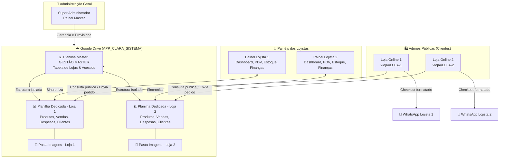

# 🛍️ Clara Gestão — Plataforma SaaS Multi-Lojas, PDV & E-Commerce

> Sistema completo de gestão empresarial, ponto de venda (PDV), vitrine online pública para clientes e controle financeiro integrado com backend moderno em **Supabase (PostgreSQL Multi-Tenant)** e suporte híbrido retrocompatível a **Google Drive / Google Sheets**.

---

## 📑 Sumário

- [Visão Geral](#-visão-geral)
- [Nichos de Negócio Atendidos](#-nichos-de-negócio-atendidos)
- [Arquitetura do Ecossistema](#-arquitetura-do-ecossistema)
- [Módulos & Funcionalidades](#-módulos--funcionalidades)
  - [1. Painel Master (Super Admin)](#1-painel-master-super-admin)
  - [2. Painel do Lojista (Gestão Completa)](#2-painel-do-lojista-gestão-completa)
  - [3. Loja Online Pública (E-Commerce para Clientes)](#3-loja-online-pública-e-commerce-para-clientes)
  - [4. Segurança & LGPD](#4-segurança--lgpd)
- [Estrutura de Arquivos](#-estrutura-de-arquivos)
- [Como Configurar e Usar](#-como-configurar-e-usar)
  - [Execução Local](#1-execução-local-frontend)
  - [Configuração do Supabase (Recomendado)](#2-configuração-do-supabase-recomendado)
  - [Configuração do Google Apps Script (Legado)](#3-configuração-do-backend-google-apps-script-legado)
- [Credenciais Padrão](#-credenciais-de-acesso)
- [Tecnologias Utilizadas](#-tecnologias-utilizadas)
- [Histórico de Versões](#-histórico-de-versões)

---

## 🌟 Visão Geral

O **Clara Gestão** foi concebido como uma solução **Multi-Tenant (SaaS)** de alta performance e resiliência, permitindo gerenciar múltiplas lojas independentes a partir de um único painel administrativo central (**Painel Master**).

A partir da versão **4.0.0**, a plataforma opera nativamente sobre **Supabase (PostgreSQL Relacional)** com:
- **Transações ACID atômicas** para vendas e controle de estoque sem risco de inconsistências;
- **Telemetria e métricas ao vivo** do comportamento de compra e intenções de sacola na vitrine online;
- **Storage dedicado** de alto desempenho para imagens de produtos e marcas;
- **Padrão Adaptador (`DatabaseAdapter`)** que permite alternar a qualquer momento entre **Supabase** e **Google Drive** diretamente pela interface master sem qualquer refatoração.

---

## 🎯 Nichos de Negócio Atendidos

A plataforma conta com campos dinâmicos e regras de negócio personalizadas para atender com excelência aos seguintes nichos:

1. **Perfumaria & Cosméticos:**
   - Controle de **Data de Validade do Lote** no cadastro de produtos;
   - Alertas visuais automáticos de validade no Estoque e no Dashboard (itens vencidos ou vencendo em até 30 dias);
   - Ficha da cliente com histórico de preferências olfativas, tom de base e tipo de pele.

2. **Brechós & Moda Circular:**
   - Classificação por **Condição da Peça** (*Novo com etiqueta*, *Seminovo impecável*, *Usado bom estado*, *Vintage/Raridade*, *Customizado/Upcycling*);
   - **Medidas Reais em cm** (Busto, cintura, quadril, comprimento, ombro);
   - Opção de **💎 Peça Única** que trava o estoque em 1 un e estampa badge exclusiva na vitrine;
   - Controle de **Consignação** com registro de Consignante e % de Repasse.

3. **Salões de Beleza & Clínicas de Estética:**
   - Seletor dinâmico de **Tipo de Item (Produto Físico vs. Serviço)**;
   - Para serviços: dispensa de controle de estoque físico e badges de identificação `✂️ Serviço`;
   - Ficha técnica da cliente para histórico de procedimentos químicos, cortes e preferências.

4. **Vestuário, Acessórios e Varejo Geral:**
   - Controle de variações de cor e tamanho, leitor de código de barras por câmera, cálculo de margem e markup reversos.

---

## 🏛️ Arquitetura do Ecossistema



### Estrutura Padronizada no Google Drive
Ao acionar o botão **"Organizar Pastas no Drive"**, o sistema organiza automaticamente o Drive na seguinte hierarquia:
```text
📁 APP_CLARA_SISTEMA/
├── 📊 GESTÃO MASTER (Planilha central de lojas e usuários)
├── 📁 [LOJA-1] Mary Variedades/
│   ├── 📊 Banco de Dados - Mary Variedades (Planilha dedicada)
│   └── 📁 Imagens/ (Logos e fotos de produtos)
└── 📁 [LOJA-2] Tech Imports/
    ├── 📊 Banco de Dados - Tech Imports
    └── 📁 Imagens/
```

---

## 📦 Módulos & Funcionalidades

### 1. Painel Master (Super Admin)
- **Visão Geral e Faturamento Global:** Faturamento acumulado de todas as lojas, total de produtos e contas a receber consolidadas;
- **Busca e Filtro em Tempo Real:** Pesquisa rápida por nome, responsável ou ID, além de filtro por status (*Todas*, *Ativas*, *Bloqueadas*);
- **Criação de Novas Lojas:** Criação instantânea com geração automática de planilha dedicada e pastas no Google Drive;
- **Visualização Detalhada da Loja (`#modalVerLojaMaster`):** Métricas, login, revelação de senha, link direto para a planilha no Sheets, link público da vitrine e atalho para conversa no WhatsApp;
- **Edição Completa de Lojas:** Alteração de nome, responsável, senha, WhatsApp e status de bloqueio;
- **Login como Lojista (*Impersonation*):** Permite ao administrador master assumir o ambiente de qualquer loja com um único clique.

### 2. Painel do Lojista (Gestão Completa)
- **Dashboard & Indicadores em Tempo Real:**
  - 5 cards estratégicos: *Vendas Hoje*, *Vendas no Mês*, *A Receber*, *Despesas do Mês* e *Lucro Líquido Real*;
  - Apuração do Lucro Líquido Real: $\text{Lucro Líquido} = \text{Faturamento Líquido} - \text{CMV} - \text{Despesas Operacionais}$;
  - Gráfico de evolução de vendas e ranking dos produtos mais vendidos;
  - Banners automáticos de validade próxima e estoque baixo.
- **PDV / Caixa Rápido:**
  - Busca inteligente de produtos, seleção de clientes e leitor de código de barras por webcam/câmera traseira;
  - Descontos em valor ou %, opções de pagamento (Dinheiro, Pix, Cartão de Débito, Cartão de Crédito e Crediário/A Prazo);
  - Impressão de recibo e cupom não fiscal formatado para impressoras térmicas (58mm/80mm) ou papel A4.
- **Gestão de Estoque & Produtos:**
  - Cadastro completo com fotos (upload direto e compressão inteligente);
  - Calculadora de Preço: Preço Custo $\rightarrow$ Markup (%) $\rightarrow$ Preço Venda;
  - Trava de pagamento exclusivo à vista para peças em promoção;
  - Exportação da base de produtos em CSV formatado para Excel.
- **Vendas & Contas a Receber:**
  - Listagem unificada de vendas presenciais e pedidos da loja online;
  - Visualização de itens e detalhes da venda (`#modalDetalhesVenda`);
  - **Cancelamento com Auditoria:** Registro obrigatório do motivo do cancelamento e **estorno automático das peças para o estoque**;
  - **Cobrança Humanizada no WhatsApp:** Botão com disparo automático de mensagem cordial contendo dados da compra, saldo pendente, vencimento e chave Pix da loja.
- **Módulo de Despesas & Fluxo de Caixa:**
  - Tela dedicada (`#tela-despesas`) com filtros por categoria e mês/ano de apuração;
  - Categorias pré-definidas: Aluguel, Energia/Água, Embalagens, Marketing/Anúncios, Salários/Retiradas, Repasses de Consignação e Outros.
- **Cadastro de Clientes:**
  - Cadastro com WhatsApp, endereço completo e ficha de preferências/histórico;
  - Exportação de clientes para CSV compatível com Excel.
- **Customização de Marca & E-Commerce:**
  - Escolha de cor tema da loja (paleta rápida ou seletor hexadecimal);
  - Upload de Logotipo e configuração de Slogan e Banner de Comunicados;
  - Configuração de taxa de entrega para delivery e chave Pix da loja;
  - **Dois Modelos de Parcelamento:**
    - *Modelo 1:* Valor mínimo por parcela (ex: min R\$ 50,00 até 6x);
    - *Modelo 2:* Tabela de faixas fixas totalmente editável (ex: até R\$ 100 em 1x, até R\$ 300 em 3x).

### 3. Loja Online Pública (E-Commerce para Clientes)
- Acessível por link direto (`?loja=ID` ou `?loja=login`), **sem necessidade de login ou senha do cliente**;
- Design responsivo para celulares e desktops com adaptação às cores da marca da loja;
- Modal de detalhes do produto com fotos em alta definição, medidas reais em cm, descrição e badges de oferta;
- Sacola de compras flutuante com cálculo automático de subtotal, taxa de entrega (ou retirada grátis);
- Validação automática de formas de parcelamento e trava de itens à vista;
- Finalização de pedido com geração de mensagem estruturada e envio direto para o WhatsApp do lojista.

### 4. Segurança & LGPD
- **Criptografia de Senhas:** Suporte a hash **SHA-256** no navegador e backend;
- **Isolamento Físico de Dados:** Cada loja possui sua própria planilha no Google Sheets;
- **Conformidade LGPD:** Termos de privacidade no checkout online e suporte à exclusão definitiva de clientes (Direito ao Esquecimento - Art. 18).

---

## 📁 Estrutura de Arquivos

```text
App-Gestao/
├── index.html                      # Aplicação Frontend completa (Painéis, PDV e Vitrine Pública)
├── google_apps_script.js           # Backend Serverless (API REST para Google Apps Script / Google Sheets)
├── COMO_CONFIGURAR_GOOGLE_DRIVE.md # Manual passo a passo para configuração inicial do Google Drive
├── HISTORICO_ALTERACOES.md         # Registro cronológico de versões, testes e homologações
├── PLANEJAMENTO_MIGRACAO_BANCO.md  # Especificação técnica e roteiro de migração para Supabase (PostgreSQL)
└── README.md                       # Documentação geral do projeto
```

---

## 🚀 Como Configurar e Usar

### 1. Execução Local (Frontend)
Não requer instalação de Node.js, compilação ou servidores complexos:
1. Dê um duplo clique no arquivo [`index.html`](file:///c:/Users/victo/OneDrive/Documentos/GitHub/App-Gestao/index.html) para abrir diretamente no Google Chrome, Microsoft Edge ou qualquer navegador moderno;
2. O sistema inicializa automaticamente com banco de dados local no `localStorage` para testes imediatos (Modo Demo).

### 2. Configuração do Backend (Google Apps Script)
Para habilitar a sincronização em nuvem e o provisionamento de planilhas dedicadas no Google Drive:

1. Acesse o [Google Drive](https://drive.google.com) com a sua conta Google;
2. Crie uma nova planilha ou acesse o [Google Apps Script](https://script.google.com);
3. Abra o editor de código do Apps Script e copie todo o conteúdo do arquivo [`google_apps_script.js`](file:///c:/Users/victo/OneDrive/Documentos/GitHub/App-Gestao/google_apps_script.js);
4. Cole no editor, substituindo o código existente, e clique em **Salvar**;
5. Clique em **Implantar** $\rightarrow$ **Nova Implantação**:
   - Tipo: **Aplicativo da Web**;
   - Executar como: **Eu (seu email)**;
   - Quem pode acessar: **Qualquer pessoa** *(necessário para a vitrine online pública dos clientes)*;
6. Copie a **URL do Aplicativo da Web** gerada (terminada em `/exec`);
7. No sistema Clara Gestão, faça login como Master (`admin` / `123`), cole a URL no campo de conexão do Google Drive e clique em **Conectar Banco Google Drive**.

---

## 🔑 Credenciais de Acesso

O sistema possui telas protegidas e exige login obrigatório:

| Perfil | Usuário | Senha Padrão | Escopo de Acesso |
| :--- | :--- | :--- | :--- |
| **👑 Administrador Master** | `admin` | `123` *(ou `admin123`)* | Gestão geral de todas as lojas, infraestrutura do Drive e criação de bancos de dados. |
| **🏪 Lojista 1 (Moda & Perfumaria)** | `moda` | `123` | Painel exclusivo da loja: Estoque, PDV, Cobrança, Marca e Despesas. |
| **🛍️ Cliente (Vitrine Pública)** | *Sem login* | *Sem senha* | Acesso direto via URL `index.html?loja=LOJA-1`. |

---

## 🛠️ Tecnologias Utilizadas

- **Frontend:** HTML5 semântico, JavaScript moderno (ES6+, Async/Await, Web Crypto API com SHA-256);
- **Estilização:** [Tailwind CSS](https://tailwindcss.com) (via CDN);
- **Componentes Visuais & Ícones:** [Lucide Icons](https://lucide.dev) e [SweetAlert2](https://sweetalert2.github.io);
- **Gráficos & Dashboards:** [Chart.js](https://www.chartjs.org);
- **Leitor de Código de Barras:** [Html5-QRCode](https://github.com/mebjas/html5-qrcode);
- **Backend & Banco de Dados:** [Google Apps Script](https://developers.google.com/apps-script) + [Google Sheets](https://www.google.com/sheets/about) + [Google Drive API](https://developers.google.com/drive);
- **Mensageria & Checkout:** Integração com a API do WhatsApp (`wa.me`).

---

## 📜 Histórico de Versões

- **Versão 3.8.2 (10/11/2026):** Exibição detalhada de Preço / Subtotal, Desconto (inclusive em promoções) e Preço Final na seção de vendas, carrinho do PDV, modal de detalhes da venda e comprovante impresso; bloqueio e travas rigorosas para não permitir adicionar ao carrinho itens sem estoque no Caixa.
- **Versão 3.8.1 (09/11/2026):** Correção de corte no topo de modais em telas verticais de smartphones, homologação do modal de visualização master via ícone de olho e tela global de carregamento do banco de dados.
- **Versão 3.8.0 (09/11/2026):** Módulo de nichos (Perfumaria, Brechó e Salão de Beleza), alertas de validade de lotes, cobrança humanizada no WhatsApp com Pix, módulo de despesas com apuração de Lucro Líquido Real e ficha de clientes.
- **Versão 3.7.0 (09/11/2026):** Visualização detalhada e edição completa de lojas no Painel Master.
- **Versão 3.6.0 (08/11/2026):** Tabela de faixas de parcelamento editável, trava de pagamento à vista em promoções e visualização detalhada de produtos na vitrine.
- **Versão 3.5.0 (05/11/2026):** Cancelamento seguro de vendas com estorno de estoque e ficha de auditoria de motivos.

Para consultar o histórico detalhado de todas as versões, consulte o arquivo [`HISTORICO_ALTERACOES.md`](file:///c:/Users/victo/OneDrive/Documentos/GitHub/App-Gestao/HISTORICO_ALTERACOES.md).

---

<p align="center">
  Desenvolvido com foco em usabilidade, segurança e eficiência operacional.
</p>

