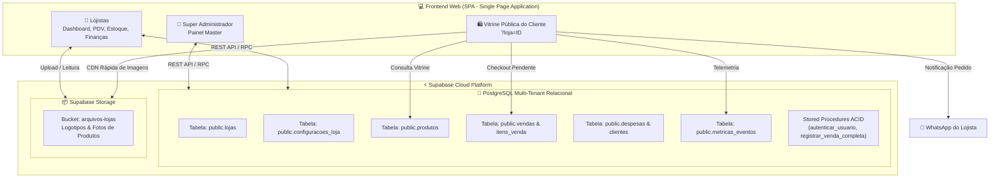

# 🛍️ Gestão Multi-lojas e E-Commerce

> Sistema completo de gestão empresarial, ponto de venda (PDV), vitrine online pública para clientes e controle financeiro integrado com backend moderno e seguro em **Supabase (PostgreSQL Multi-Tenant)** e **Supabase Storage**.

---

## 📑 Sumário

- [Visão Geral](#-visão-geral)
- [Nichos de Negócio Atendidos](#-nichos-de-negócio-atendidos)
- [Arquitetura do Ecossistema](#-arquitetura-do-ecossistema)
- [Módulos & Funcionalidades](#-módulos--funcionalidades)
  - [1. Painel Master (Super Admin)](#1-painel-master-super-admin)
  - [2. Painel do Lojista (Gestão Completa)](#2-painel-do-lojista-gestão-completa)
  - [3. Loja Online Pública (E-Commerce para Clientes)](#3-loja-online-pública-e-commerce-para-clientes)
  - [4. Segurança & LGPD](#4-segurança--lgpd)
- [Estrutura de Arquivos](#-estrutura-de-arquivos)
- [Como Configurar e Usar](#-como-configurar-e-usar)
  - [1. Execução Local](#1-execução-local-frontend)
  - [2. Configuração do Supabase & Blindagem](#2-configuração-do-supabase--blindagem-de-segurança)
- [Credenciais Padrão](#-credenciais-de-acesso)
- [Tecnologias Utilizadas](#-tecnologias-utilizadas)
- [Histórico de Versões](#-histórico-de-versões)

---

## 🌟 Visão Geral

A plataforma **Gestão Multi-lojas e E-Commerce** foi concebida como uma solução **Multi-Tenant (SaaS)** de alta performance e resiliência, permitindo gerenciar múltiplas lojas independentes a partir de um único painel administrativo central (**Painel Master**).

A partir da versão **4.1.0**, o ecossistema opera de forma **100% nativa sobre Supabase (PostgreSQL Relacional)** com independência total do Google Drive:
- **Transações ACID atômicas** para vendas e controle de estoque sem risco de inconsistências;
- **Supabase Storage CDN** dedicado para imagens de produtos e logotipos, entregando carregamento ultra-rápido;
- **Telemetria e métricas ao vivo** do comportamento de compra e intenções de sacola na vitrine online;
- **Blindagem de segurança para código aberto (`security_hardening.sql`)** com proteção de coluna de senha (`senha_hash`), autenticação via RPC Security Definer e políticas RLS.

---

## 🎯 Nichos de Negócio Atendidos

A plataforma conta com campos dinâmicos e regras de negócio personalizadas para atender com excelência aos seguintes nichos:

1. **Perfumaria & Cosméticos:**
   - Controle de **Data de Validade do Lote** no cadastro de produtos;
   - Alertas visuais automáticos de validade no Estoque e no Dashboard (itens vencidos ou vencendo em até 30 dias);
   - Ficha da cliente com histórico de preferências olfativas, tom de base e tipo de pele.

2. **Brechós & Moda Circular:**
   - Classificação por **Condição da Peça** (*Novo com etiqueta*, *Seminovo impecável*, *Usado bom estado*, *Vintage/Raridade*, *Customizado/Upcycling*);
   - **Medidas Reais em cm** (Busto, cintura, quadril, comprimento, ombro);
   - Opção de **💎 Peça Única** que trava o estoque em 1 un e estampa badge exclusiva na vitrine;
   - Controle de **Consignação** com registro de Consignante e % de Repasse.

3. **Salões de Beleza & Clínicas de Estética:**
   - Seletor dinâmico de **Tipo de Item (Produto Físico vs. Serviço)**;
   - Para serviços: dispensa de controle de estoque físico e badges de identificação `✂️ Serviço`;
   - Ficha técnica da cliente para histórico de procedimentos químicos, cortes e preferências.

4. **Vestuário, Acessórios e Varejo Geral:**
   - Controle de variações de cor e tamanho, leitor de código de barras por câmera, cálculo de margem e markup reversos.

---

## 🏛️ Arquitetura do Ecossistema



---

## 📦 Módulos & Funcionalidades

### 1. Painel Master (Super Admin)
- **Visão Geral e Faturamento Global:** Faturamento acumulado de todas as lojas, total de produtos e contas a receber consolidadas;
- **Busca e Filtro em Tempo Real:** Pesquisa rápida por nome, responsável ou ID, além de filtro por status (*Todas*, *Ativas*, *Bloqueadas*);
- **Criação de Novas Lojas:** Criação instantânea de loja e configurações iniciais no banco de dados Supabase;
- **Visualização Detalhada da Loja (`#modalVerLojaMaster`):** Métricas, login, status da loja, link público da vitrine e atalho para conversa no WhatsApp;
- **Edição Completa de Lojas:** Alteração de nome, responsável, senha, WhatsApp e status de bloqueio;
- **Login como Lojista (*Impersonation*):** Permite ao administrador master assumir o ambiente de qualquer loja com um único clique.

### 2. Painel do Lojista (Gestão Completa)
- **Dashboard & Indicadores em Tempo Real:**
  - 5 cards estratégicos: *Vendas Hoje*, *Vendas no Mês*, *A Receber*, *Despesas do Mês* e *Lucro Líquido Real*;
  - Apuração do Lucro Líquido Real: $\text{Lucro Líquido} = \text{Faturamento Líquido} - \text{CMV} - \text{Despesas Operacionais}$;
  - Gráfico in-place de evolução de vendas e ranking dos produtos mais vendidos;
  - Banners automáticos de validade próxima e estoque baixo.
- **PDV / Caixa Rápido:**
  - Busca inteligente de produtos, seleção de clientes e leitor de código de barras por webcam/câmera traseira;
  - Descontos em valor ou %, opções de pagamento (Dinheiro, Pix, Cartão de Débito, Cartão de Crédito e Crediário/A Prazo);
  - Impressão de recibo e cupom não fiscal formatado para impressoras térmicas (58mm/80mm) ou papel A4.
- **Gestão de Estoque & Produtos:**
  - Cadastro completo com upload direto de fotos para o Supabase Storage;
  - Calculadora de Preço: Preço Custo $\rightarrow$ Markup (%) $\rightarrow$ Preço Venda;
  - Trava de pagamento exclusivo à vista para peças em promoção;
  - Exportação da base de produtos em CSV formatado para Excel.
- **Vendas & Contas a Receber:**
  - Listagem unificada de vendas presenciais e pedidos da loja online;
  - Visualização de itens e detalhes da venda (`#modalDetalhesVenda`);
  - **Cancelamento com Auditoria:** Registro obrigatório do motivo do cancelamento e **estorno automático das peças para o estoque** via procedure ACID;
  - **Cobrança Humanizada no WhatsApp:** Botão com disparo automático de mensagem cordial contendo dados da compra, saldo pendente, vencimento e chave Pix da loja.
- **Módulo de Despesas & Fluxo de Caixa:**
  - Tela dedicada (`#tela-despesas`) com filtros por categoria e mês/ano de apuração;
  - Categorias pré-definidas: Aluguel, Energia/Água, Embalagens, Marketing/Anúncios, Salários/Retiradas, Repasses de Consignação e Outros.
- **Cadastro de Clientes:**
  - Cadastro com WhatsApp, endereço completo e ficha de preferências/histórico;
  - Exportação de clientes para CSV compatível com Excel.
- **Customização de Marca & E-Commerce:**
  - Escolha de cor tema da loja (paleta rápida ou seletor hexadecimal);
  - Upload de Logotipo e configuração de Slogan e Banner de Comunicados;
  - Configuração de taxa de entrega para delivery e chave Pix da loja;
  - **Dois Modelos de Parcelamento:**
    - *Modelo 1:* Valor mínimo por parcela (ex: min R\$ 50,00 até 6x);
    - *Modelo 2:* Tabela de faixas fixas totalmente editável (ex: até R\$ 100 em 1x, até R\$ 300 em 3x).

### 3. Loja Online Pública (E-Commerce para Clientes)
- Acessível por link direto (`?loja=ID` ou `?loja=login`), **sem necessidade de login ou senha do cliente**;
- Design responsivo para celulares e desktops com adaptação às cores da marca da loja;
- Modal de detalhes do produto com fotos em alta definição servidas pelo Supabase Storage CDN, medidas reais em cm, descrição e badges de oferta;
- Sacola de compras flutuante com cálculo automático de subtotal, taxa de entrega (ou retirada grátis);
- Validação automática de formas de parcelamento e trava de itens à vista;
- Finalização de pedido com geração de mensagem estruturada e envio direto para o WhatsApp do lojista.

### 4. Segurança & LGPD
- **Criptografia de Senhas:** Suporte a hash **SHA-256** no navegador e Stored Procedure `autenticar_usuario` com `SECURITY DEFINER`;
- **Proteção de Dados Sensíveis:** Permissão de leitura restrita em `public.lojas`, revogando `senha_hash` do papel anônimo (`anon`);
- **Políticas RLS:** Políticas de Row Level Security ativas para controle de leitura e escrita;
- **Conformidade LGPD:** Termos de privacidade no checkout online e suporte à exclusão definitiva de clientes (Direito ao Esquecimento - Art. 18).

---

## 📁 Estrutura de Arquivos

```text
App-Gestao-Supabase/
├── index.html                      # Aplicação Frontend completa (Painéis, PDV e Vitrine Pública)
├── security_hardening.sql          # Script SQL de blindagem de segurança (PostgreSQL / Supabase)
├── HISTORICO_ALTERACOES.md         # Registro cronológico detalhado de versões e homologações
├── README.md                       # Documentação geral do ecossistema
└── legado_google_drive/            # Arquivo histórico (backend legado em Google Apps Script / Sheets)
    ├── google_apps_script.js       # Script legado do Google Apps Script
    └── COMO_CONFIGURAR_GOOGLE_DRIVE.md
```

---

## 🚀 Como Configurar e Usar

### 1. Execução Local (Frontend)
Não requer instalação de Node.js, compilação ou servidores locais:
1. Dê um duplo clique no arquivo [`index.html`](file:///c:/Users/victo/OneDrive/Documentos/GitHub/App-Gestao-Supabase/index.html) para abrir diretamente no Google Chrome, Microsoft Edge ou qualquer navegador moderno;
2. O sistema conecta-se automaticamente ao projeto Supabase configurado via SDK CDN.

### 2. Configuração do Supabase & Blindagem de Segurança
1. No painel do seu projeto no [Supabase](https://supabase.com/dashboard):
2. Abra a aba **SQL Editor**;
3. Execute o script [`security_hardening.sql`](file:///c:/Users/victo/OneDrive/Documentos/GitHub/App-Gestao-Supabase/security_hardening.sql);
4. O script aplica as regras de segurança para publicação:
   - Revoga a visibilidade da coluna `senha_hash` de consultas anônimas;
   - Ativa as regras de Row Level Security (RLS);
   - Configura as permissões públicas de leitura e upload no bucket `arquivos-lojas`.

### 3. Notificações Automáticas no Telegram (Opcional & Recomendado)
1. Para ativar o envio automático de notificações de vendas para o Telegram dos lojistas:
2. No painel do **Supabase -> SQL Editor**, execute o script [`telegram_notifications.sql`](file:///c:/Users/victo/OneDrive/Documentos/GitHub/App-Gestao-Supabase/telegram_notifications.sql);
3. No painel do **Administrador Master**, informe o `@username` e o `Token HTTP` do seu bot oficial gerado no BotFather do Telegram;
4. No painel de cada loja, na aba **Minha Loja Online & Marca**, basta ativar o switch e preencher o **Chat ID** do lojista (com botão de teste instantâneo).

---

## 🔑 Credenciais de Acesso

O sistema possui telas protegidas e exige login obrigatório:

| Perfil | Usuário | Senha Padrão | Escopo de Acesso |
| :--- | :--- | :--- | :--- |
| **👑 Administrador Master** | `admin` | `123` *(ou `admin123`)* | Gestão geral de todas as lojas e criação de novos ambientes. |
| **🏪 Lojista 1 (Mary Variedades)** | `moda` | `123` | Painel exclusivo da loja: Estoque, PDV, Cobrança, Marca e Despesas. |
| **🛍️ Cliente (Vitrine Pública)** | *Sem login* | *Sem senha* | Acesso direto via URL `index.html?loja=LOJA-1`. |

---

## 🛠️ Tecnologias Utilizadas

- **Frontend:** HTML5 semântico, JavaScript moderno (ES6+, Async/Await, Web Crypto API com SHA-256);
- **Estilização:** [Tailwind CSS](https://tailwindcss.com) (via CDN);
- **Componentes Visuais & Ícones:** [Lucide Icons](https://lucide.dev) e [SweetAlert2](https://sweetalert2.github.io);
- **Gráficos & Dashboards:** [Chart.js](https://www.chartjs.org);
- **Leitor de Código de Barras:** [Html5-QRCode](https://github.com/mebjas/html5-qrcode);
- **Backend em Nuvem & Banco de Dados:** [Supabase](https://supabase.com) + [PostgreSQL](https://www.postgresql.org) (Stored Procedures, RLS, Views e Triggers);
- **Armazenamento de Mídia:** [Supabase Storage](https://supabase.com/storage) (Bucket `arquivos-lojas` com CDN global);
- **Mensageria & Notificações:**
  - **WhatsApp (`wa.me`):** Envio manual de pedidos gerados pelo cliente final na vitrine pública;
  - **Telegram Bot API (`api.telegram.org`):** Disparo automatizado instantâneo de novos pedidos online, vendas no PDV e cancelamentos diretamente para o Telegram do lojista.

---

## 📜 Histórico de Versões

- **Versão 4.3.0 (14/11/2026):** Integração automatizada de notificações de vendas via Telegram Bot API (novos pedidos da vitrine online, vendas no balcão/PDV e cancelamentos de vendas); card de configuração do Bot Central da plataforma no Painel Master; painel do lojista na aba Loja Online com toggle de ativação, guia passo a passo, campo de Chat ID, checkboxes de granularidade de eventos, botão de teste imediato e suporte a bot próprio; script de migração Supabase [`telegram_notifications.sql`](file:///c:/Users/victo/OneDrive/Documentos/GitHub/App-Gestao-Supabase/telegram_notifications.sql) com fallback defensivo no frontend.
- **Versão 4.2.0 (14/11/2026):** Módulo de Histórico Completo de Vendas do Cliente na aba Clientes com filtros de período (Hoje, 7 dias, Mês, Todas) e status financeiro (Quitadas, Pendentes, Canceladas), cards de resumo financeiro por cliente e links diretos para detalhes da venda; funcionalidade de atribuição de vendas online e balcão a clientes cadastrados com busca instantânea e atalho de cadastro pré-preenchido.
- **Versão 4.1.1 (14/11/2026):** Correção do roteamento inicial do Painel Master no login de admin e retorno direto ao sair da impersonação de loja; compressão automática de fotos de celulares via HTML5 Canvas (evitando estouro de cota de armazenamento local); filtros dinâmicos de período (Hoje, 7 Dias, Mês e Todas) no Gráfico de Vendas e nas Métricas da Vitrine Online.
- **Versão 4.1.0 (14/11/2026):** Descontinuação definitiva do Google Drive, migração de 100% das imagens para o Supabase Storage (`arquivos-lojas`), blindagem de segurança PostgreSQL (`security_hardening.sql`) com proteção de `senha_hash` para liberação do repositório público no GitHub.
- **Versão 4.0.2 (11/11/2026):** Eliminação do ciclo assíncrono infinito na navegação do Dashboard e Pedidos, otimização in-place do gráfico Chart.js (sem recriações de canvas ou tremor) e mutex de concorrência na sincronização de dados.
- **Versão 4.0.1 (11/11/2026):** Mapeamento do status de novos pedidos online da vitrine para `'Pendente'`, fluxo assíncrono com bloqueio preventivo de erro 400 no Supabase e eliminação do registro anônimo "Produto sem nome" no ranking de mais desejados na sacola.
- **Versão 4.0.0 (11/11/2026):** Migração completa para Supabase (PostgreSQL Multi-Tenant), stored procedures para transações atômicas ACID de vendas e estoque, storage de arquivos de mídia, telemetria em tempo real e camada de compatibilidade híbrida (`DatabaseAdapter`).

Para consultar o histórico detalhado de todas as versões anteriores, consulte o arquivo [`HISTORICO_ALTERACOES.md`](file:///c:/Users/victo/OneDrive/Documentos/GitHub/App-Gestao-Supabase/HISTORICO_ALTERACOES.md).

---

<p align="center">
  Desenvolvido com foco em usabilidade, segurança e eficiência operacional.
</p>


